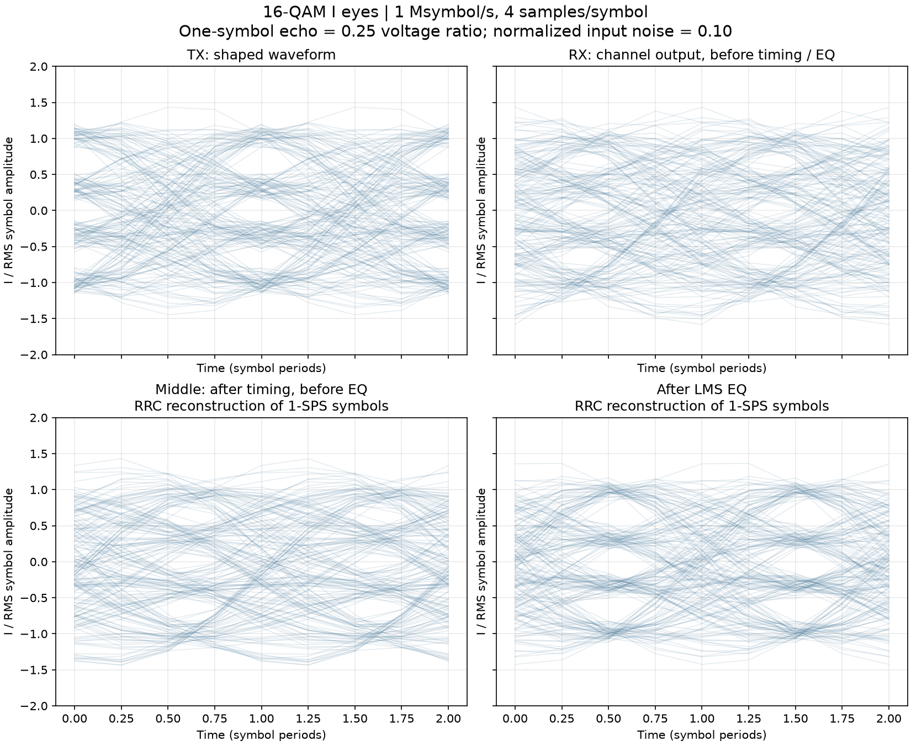
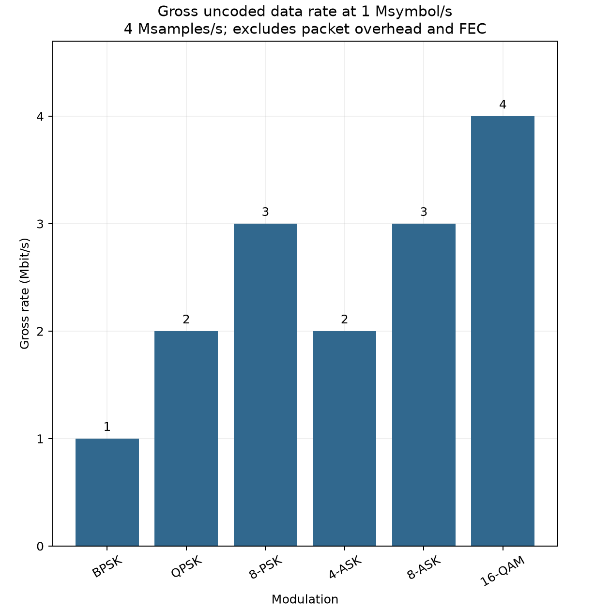

# Single-carrier antenna lab

Start with one simple, flat GNU Radio flowchart. Every processing and display block comes with GNU Radio; there are no project-specific blocks, Embedded Python blocks, or project hierarchical modules.

## Open and run

Double-click **Open Benchmark GRC.command**, or open just one example:

```sh
cd /Users/ofi/repos/grc
antenna-grc grc/single_carrier_16qam.grc
```

Generate **F5**, run **F6**, stop **F7**. Change Parameter or Variable values in GRC, then generate and restart.

| Example | Editable source | Bits/symbol | TX reference delay |
| --- | --- | ---: | ---: |
| BPSK (2-ASK) | [BPSK](grc/single_carrier_bpsk.grc) | 1 | 34 bits |
| QPSK | [QPSK](grc/single_carrier_qpsk.grc) | 2 | 68 bits |
| 8-PSK | [8-PSK](grc/single_carrier_8psk.grc) | 3 | 102 bits |
| 4-ASK | [4-ASK](grc/single_carrier_4ask.grc) | 2 | 68 bits |
| 8-ASK | [8-ASK](grc/single_carrier_8ask.grc) | 3 | 102 bits |
| 16-QAM | [16-QAM](grc/single_carrier_16qam.grc) | 4 | 136 bits |

These cover the modulation examples in the downloaded [GNU Radio tutorial](https://wiki.gnuradio.org/index.php?title=M-ASK_Mod_and_Demod_and_QAM-M_Mod_and_Demod). Each graph is independently editable. They share a readable builder only to recreate the starting examples.

## Follow the signal

**Random Source → Constellation Modulator → Multiply Const (TX power) → Throttle → Channel Model → Multiply Const (known RX level) → Polyphase Clock Sync → Multiply Const (RX scale) → Linear Equalizer (LMS) → Constellation Decoder.**

The lower rows contain **Differential Decoder → Unpack K Bits**, the delayed TX reference, and **XOR → UChar to Float → Integrate → Multiply Const → BER number**. Virtual Sources and Sinks connect rows without long crossing wires. A matching Stream ID is just a wire continuation.

The TX scale sets nominal average conducted power consistently across modulation formats. Known RX level restoration keeps the timing detector at its normal level; the final constellation scale restores the native decision points. These gains amplify noise with the signal and preserve SNR. All examples use **1 Msymbol/s**, four samples/symbol (**4 Msamples/s**) and RRC shaping with rolloff 0.35. ASK uses the tutorial's Constellation Rect. Object, naturally ordered amplitude levels and real-sector width 2. Differential coding is enabled, as in the tutorial.

## Knobs to change first

| Control | Initial value | Meaning |
| --- | ---: | --- |
| `tx_power_dbm` | 0 | Nominal average conducted TX power, dBm |
| `path_loss_db` | 80 | Net link attenuation including antenna gains and cable losses, dB |
| `rx_noise_dbm` | −100 | Input-referred receiver noise across the complex sample bandwidth, dBm |
| `noise_enabled` | 1 | Set 0 for a noiseless alignment test; 1 enables the specified noise |
| `symbol_rate` | 1000000 | Baseline symbol rate, symbols/s |
| `samp_rate` | `symbol_rate*sps` = 4000000 | Logical waveform rate and default playback speed, samples/s |
| `bit_rate` | `symbol_rate*k` | Gross uncoded bit rate, bit/s |
| `sps` | 4 | Samples/symbol; symbol rate = sample rate / sps |
| `alpha` | 0.35 | RRC excess bandwidth |
| `reference_delay` | Table above | Delay the clean TX bit stream to match received bits |
| `ber_window` | 10000 | Compared bits per displayed BER estimate |
| `warmup_bits` | 4096 | Initial bits excluded for filter/timing-loop startup |
| `eq_taps` | 11 | Symbol-spaced adaptive LMS equalizer length |
| `eq_step` | 0.01 | Adaptation step, normalized by tap count and native symbol power |
| `channel_echo` | 0 | One-symbol echo voltage ratio; try 0.25 |

Plots use **six resizable tabs, each with four charts in a 2×2 grid**: constellations, waveforms/spectrum/timing, I eyes, link budget, Q eyes, and BER/EVM/tap histories. Numerical meters occupy separate rows. Each plot uses the rate of the stream it receives: 4 Msamples/s for waveforms/eyes, 1 Msymbol/s for symbol diagnostics, and bit rate / window length for BER history.

The BER number describes the **latest nonoverlapping 10,000-bit window**. It is not cumulative. The first warmup bits are excluded from both streams. A noisy-looking waveform can still produce zero observed errors over a short interval.

For scored BER, initially leave Channel Model **Frequency Offset = 0**, **Epsilon = 1**, and use **`channel_echo = 0`** for a flat channel. Clock Sync recovers symbol timing; this starter receiver has no carrier-recovery loop. Changing filters, samples/symbol, or timing settings can change the required bit delay. Recheck alignment in a noiseless run after such edits. The tutorial delay formula is a starting point; the table above was measured on this GNU Radio installation.

## Adaptive equalization and eyes

The original timing-only receiver now includes the stock **Linear Equalizer** and **Adaptive Algorithm (LMS)** blocks. Clock Sync produces one sample/symbol; an **11-tap, symbol-spaced, decision-directed LMS** filter then reduces residual ISI before decoding. It uses the selected constellation for decisions. `eq_step = 0.01` is divided by `eq_taps * symbol_rms**2` to set the native LMS step. Lower steps converge more slowly; overly large steps can diverge.

The equalizer starts as a centered identity filter. A stock Python Snippet calls its public `set_taps()` method once; the adaptive filtering itself runs entirely inside GNU Radio's native block. At 11 taps this adds five symbols of latency, included in the updated reference delays above. Changing equalizer length, filters or timing can require a fresh noiseless delay check. Decision-directed acquisition assumes usable initial decisions and does not replace carrier recovery.

Set **`channel_echo = 0.25`** to add a delayed copy one symbol after the direct path, at 25% voltage. The channel taps are normalized by `sqrt(1 + channel_echo**2)` to preserve nominal total tap energy and approximate average link loss for random data. Default zero keeps a flat channel. A captured 16-QAM test with this echo and normalized input noise 0.10 measured **24.7% data-aided EVM before EQ and 5.6% after EQ**, with zero observed BER over that finite capture. EVM excludes the first 1,024 symbols and can include remaining LMS convergence. This is one controlled simulation, not a guarantee for arbitrary channels.

The I and Q eye tabs each show these four stages:

| Tile | Signal | Interpretation |
| --- | --- | --- |
| TX | Actual shaped TX samples, 4 SPS | Clean reference eye |
| RX | Actual Channel Model output, 4 SPS | Noise/ISI before receiver processing |
| Middle | Clock-synchronized, scaled symbols before EQ | **RRC reconstructed** to 4 SPS for display |
| After EQ | Adaptive equalizer output at 1 SPS | **RRC reconstructed** to 4 SPS for display |

Reconstruction is a display-only stock Interpolating FIR Filter. It does not create additional measured timing information, and its output does not feed decoding/BER. The middle/post eyes visualize the symbol sequences on a common pulse shape; they are not physical oversampled receiver waveforms or automatic eye-opening measurements. The separate tap-magnitude and timing-error charts show adaptation and clock behavior directly.



[Equalizer dashboard](results/equalizer_dashboard.png), [Q eyes](results/equalizer_eyes_q.png), [captured test values](results/equalizer_checks/16qam_noise_0.1.json). The report includes these plots and independent MATLAB checks of the adaptive FIR and reconstruction.

Sources: [GNU Radio Linear Equalizer](https://wiki.gnuradio.org/index.php/Linear_Equalizer), [Adaptive Algorithm](https://wiki.gnuradio.org/index.php/Adaptive_Algorithm), [GNU Radio 3.10.12 LMS implementation](https://github.com/gnuradio/gnuradio/blob/v3.10.12.0/gr-digital/include/gnuradio/digital/adaptive_algorithm_lms.h).

## Power in dBm and link budgets

The physical controls are across the top of each graph. Start with:

- `tx_power_dbm = 0`: 1 mW nominal average conducted TX power.
- `path_loss_db = 80`: expected received signal power = −80 dBm.
- `rx_noise_dbm = -100`: total receiver noise = −100 dBm across the 4 MHz complex sample bandwidth.

For 10 dBm TX and the same loss, received signal power becomes −70 dBm. Receiver noise stays fixed. The decoder gain restores signal scale and amplifies noise equally, so increasing path loss or reducing TX power still degrades SNR.

The convention is a **power-normalized complex envelope**: `|IQ|²` is power in **milliwatts**. Unit mean-square IQ is 0 dBm. Therefore:

```text
TX amplitude multiplier = 10^(TX_dBm / 20) / constellation_RMS
Path amplitude multiplier = 10^(-net_loss_dB / 20)
RX signal power (dBm) = TX average power (dBm) - net loss (dB)
Noise RMS IQ amplitude = 10^(noise_dBm / 20)
Measured average power (dBm) = 10 log10(mean(|IQ|²))
```

For a normal link budget, use `net_loss = propagation_loss + cable_losses + other_losses - TX_gain_dBi - RX_gain_dBi`. The reference planes are the conducted TX output and receiver input. This input is **not EIRP**. Add antenna gain and subtract feeder loss explicitly in the net-loss calculation.

The **Link budget** tab shows measured TX average, RX total power (signal **plus noise**), sampled TX peak envelope power, a power history, and the sampled TX envelope in dBm. Averages and peaks use 4096-sample windows (1.024 ms at 4 Msamples/s). Average linear power is converted to dBm after averaging; averaging dBm samples would give a different result.

Average power and peak envelope power are different. `PEP_dBm = average_dBm + PAPR_dB`. The average setting is nominal for random symbols through the selected pulse-shaping filter; finite measured averages can differ slightly. The sampled peak depends on modulation, RRC rolloff, data and observation length. At four samples/symbol it can miss a continuous-time peak. The simulation has no PA clipping, compression or receiver saturation.

At 50 ohms, RF RMS voltage corresponding to power P is `sqrt(P_watts * 50)`. Under this IQ convention, RMS-equivalent envelope voltage is `sqrt(50/1000)*|IQ|`; peak sinusoidal carrier-envelope voltage is sqrt(2) times that. IQ numbers are not being treated as literal volts.

### Noise bandwidth and a receiver noise figure

`rx_noise_dbm` means noise integrated over **Fs**, the full complex simulation bandwidth. It is not a spectrum-analyzer RBW reading, nor noise over the 1.35 MHz RRC occupied bandwidth. For white noise, use:

```text
Noise in simulation bandwidth (dBm) ≈ -174 + NF_dB + 10 log10(Fs_Hz)   [290 K]
```

For Fs = 4 MHz and NF = 5 dB, enter approximately **−102.98 dBm**. If Fs changes, recompute the noise setting to keep the same noise spectral density. If you know total noise N over another bandwidth B, enter `N + 10 log10(Fs/B)`.

For this white-noise, no-FEC model, nominal `Eb/N0_dB = RX_signal_dBm - RX_noise_dBm + 10 log10(Fs / bit_rate)`. That is energy accounting, not a claim that this differential/timing-recovery receiver achieves an ideal coherent BER curve.

Sources: [Keysight thermal noise and noise figure](https://helpfiles.keysight.com/csg/pxivna/Applications/Noise_Figure.htm), [MathWorks complex AWGN noise bandwidth and energy ratios](https://www.mathworks.com/help/comm/ug/awgn-channel.html), [R&S voltage and power measurements](https://scdn.rohde-schwarz.com/ur/pws/dl_downloads/dl_common_library/dl_brochures_and_datasheets/pdf_1/SLMESS_E.PDF).

**Hardware use:** these are simulated power reference levels. A USRP's digital IQ amplitude or UHD gain value does not by itself establish RF dBm. Before applying this to a radio, calibrate average output power versus waveform, frequency and gain with suitable RF measurement equipment.

## Data rate at the baseline

At 1 Msymbol/s, gross uncoded rates are **1, 2, 3, 2, 3, and 4 Mbit/s** for BPSK, QPSK, 8-PSK, 4-ASK, 8-ASK, and 16-QAM. These are modulation bit rates, not measured packet goodput. The 0.35-rolloff RRC bandwidth is ideally 1.35 MHz null-to-null (baseband edges ±0.675 MHz).



[Rate CSV](results/data_rate.csv), [vector PDF](results/data_rate.pdf), [MATLAB rate chart](results/matlab_data_rate.png).

## RX SNR, Eb/N₀, and constellation guides

The **Link budget** tab now includes RX SNR and Eb/N₀ readouts. These use the **measured TX average power**, known path loss, and configured receiver noise. They are known-reference link-budget quantities; RX total power alone cannot separate signal from noise.

```text
RX SNR over Fs (dB) = measured_TX_dBm - net_loss_dB - noise_dBm
Eb/N0 (dB) = SNR_over_Fs + 10 log10(Fs / gross_bit_rate)
Es/N0 (dB) = SNR_over_Fs + 10 log10(Fs / symbol_rate)
```

At the default 0 dBm TX, 80 dB loss, −100 dBm noise and 4 Msamples/s, nominal SNR over Fs is **20 dB**. Nominal Eb/N₀ is **26.02 dB for BPSK**, **23.01 dB for QPSK/4-ASK**, **21.25 dB for 8-PSK/8-ASK**, and **20.00 dB for 16-QAM**. Live measured-TX readouts can differ slightly because they use finite waveform windows. With noise disabled the readouts show infinity. Noise in these equations is integrated across Fs; do not substitute a noise level measured in a narrower RBW.

The metrics tab contains separate **actual TX encoded-symbol** and **RX symbol** constellations. The TX monitor uses stock packing, Differential Encoder, and Chunks to Symbols blocks before RRC shaping. MATLAB verifies that monitor directly from the original TX bits.

Both live constellations show black ideal-point crosses and green EVM guide circles; the transmitted/received symbol samples are blue. Change **`evm_guide_percent`** (default 5%) to set the guide radius. Every circle has absolute radius `guide_percent/100 * RMS_constellation_amplitude`. A 5% circle is a visual radius reference, **not** a 95% confidence contour or an IEEE acceptance limit.

The report's RX plots also show orange circles with the **measured data-aided RMS error radius**, and example TX-to-RX error vectors. This EVM compares actual aligned TX and RX symbols using the known chain delay, without a gain/phase fit. It therefore includes wrong symbol decisions. The original stock live EVM number remains decision-directed and is labeled accordingly.

Each dashboard has **four charts arranged 2×2**. Resize the window and the plot tiles resize together; individual panels/canvases have no forced square dimensions. Constellation figures retain equal I/Q scales. A stock Python Snippet sets only the dashboard row/column stretch.

Sources: [MathWorks SNR/Eb/N₀ conversion](https://www.mathworks.com/help/comm/ref/convertsnr.html), [EVM reference-power normalization](https://www.mathworks.com/help/comm/ref/comm.evm-system-object.html).

## Displays

- Separate actual TX and RX symbol constellations, ideal references, and EVM-radius guides.
- Overlaid TX/RX baseband spectra, in relative dB.
- Overlaid TX/RX I/Q waveforms in time.
- Separate 2×2 I and Q eye dashboards: clean TX, raw channel RX, middle (after timing/before EQ), and after EQ.
- Middle and post-EQ eyes are labeled RRC reconstructions of symbol-rate streams.
- Actual adaptive LMS tap magnitudes updated during convergence, plus pre/post-EQ constellations.
- Clock-sync timing-error history.
- RX SNR over Fs and Eb/N₀ readouts.
- Data-aided EVM and SNR/Eb/N₀ comparison figures in the report.
- BER-window history and smoothed EVM history.
- BER from explicit stock arithmetic blocks.
- Stock EVM Measurement followed by RMS smoothing, displayed in percent.

**The EVM display is decision-directed:** it compares each received point with a nearby constellation decision, rather than the actual transmitted reference symbol. Wrong decisions can make EVM look deceptively good at poor SNR. The current Python/MATLAB checks also compute data-aided EVM against the actual TX symbols, which includes incorrect decisions. The FFT display remains a relative spectral view. Use the dedicated magnitude-squared power meters for dBm. BER has not been validated against an analytical Eb/N0 curve in this receiver.

## Check your saved flowcharts

```sh
python scripts/run_all.py
```

This compiles your saved `.grc` files, checks all six formats with zero and added noise plus three fixed-noise physical link-budget cases and one 16-QAM echo/equalizer case (16 cases total), verifies the BER arithmetic against independently compared bits, checks per-symbol EVM, exports the actual GRC canvases, runs independent MATLAB validation, checks absolute dBm/link-loss power and writes [the short results report](results/REPORT.md). It never runs radio hardware and does not regenerate your editable flowcharts.

Run the physical tests separately with `python scripts/check_link_budget.py`. Refresh the Markdown report from existing results with `python scripts/write_report.py`.

The runner requires this Mac's MATLAB at `/Applications/MATLAB_R2026a.app/bin/matlab`. Python exports actual bit/symbol arrays and native meter outputs in `results/*_noise_*.mat`. MATLAB independently recomputes every compared bit, each BER window, nearest-decision EVM, RMS smoothing, linear-power averaging, sampled peak power, dBm conversion, link loss, and the rate arithmetic. It additionally reconstructs each captured time-varying equalizer FIR output from its input/tap history and both display-only RRC eye waveforms. It does not merely compare previously computed summary values.

To run MATLAB checks separately after captures exist:

```matlab
addpath('matlab');
validate_single_carrier;
```

Source: [matlab/validate_single_carrier.m](matlab/validate_single_carrier.m). Results: [MATLAB validation summary](results/matlab_validation.json).

To deliberately recreate one template (overwriting that example):

```sh
python scripts/build_flowgraph.py --modulation 16qam
```

Edit `.grc` files for normal experimentation. `grc/generated/` is compiler output. `antenna_steering.py` remains the steering framework for later hardware work.

## OFDM archive

The previous OFDM/Wi-Fi project, supporting flowcharts, custom modules, Python/MATLAB code, configurations, documentation, and results are preserved under [archive/ofdm_2026-10-17](archive/ofdm_2026-10-17/README.md). The active launcher opens only these six single-carrier examples. The user's original `test_flow.grc` and `test_flow.py` are preserved in the root folder.

## Variable grouping and saved edits

The controls follow your BPSK-inspired grouping: sample rate/filter settings, RF inputs, derived RF values, BER/equalizer controls, then constellation/helper objects. `scripts/pack_controls.py` measures GRC's actual rendered block sizes and leaves **8 px gaps**, rather than using wide fixed columns. `configs/packed_controls.json` records the resulting positions. Processing starts just below this compact header.

Normal validation preserves your saved `.grc` files. To explicitly reapply the layout and chart facilities to all six saved graphs, run `python scripts/improve_charts.py`. This changes the diagram presentation and adds the documented receiver/diagnostic blocks, so save a copy before using it on an experiment with modified connections. The template builder also applies the compact layout when explicitly invoked.

## Boxed section labels in GRC

Each active flowchart has title-only blue boxed headings for controls, the transmitter, channel, receiver, BER measurement, RX diagnostics, link-budget meters, TX references, and equalization/eye displays. Double-click a heading's **Note** block to edit its wording; drag it to move the heading.

Open with `antenna-grc` or **Open Benchmark GRC.command** to see the large headings. This launcher gives only the section Notes a larger font and blue styling; it does not modify your installed GNU Radio or the signal processing. In ordinary GRC the same stock Notes remain valid, with the title stored in the Note text. These are movable labels, not containers that move the enclosed blocks as a group.

`python scripts/label_sections.py` adds any missing headings to saved graphs. Explicit template rebuilding and control repacking also recreate the headings. Normal validation preserves their saved positions.
