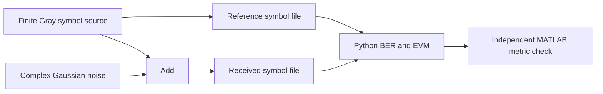
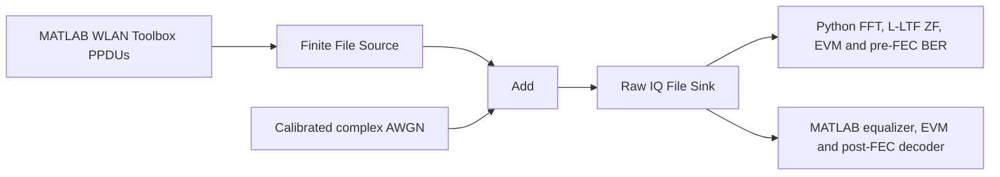
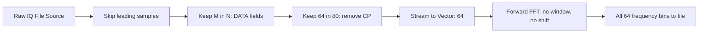

# GNU Radio flowgraphs and reproducible commands

**Start with [SISO_LABS.md](SISO_LABS.md)** for the two complete live graphs: `siso_modem_lab.grc` and `siso_wlan_lab.grc`. They calculate BER/EVM inside GNU Radio and include live constellation, spectrum, waterfall and time displays. These are the primary user-facing labs. The five graphs below remain supporting references and hardware integration templates; all hardware uses one TX or RX channel.

The new Wi-Fi SISO lab normalizes average **active PPDU** power per rate and keeps receiver noise fixed during a loss sweep. The older reference graph below uses **active DATA** SNR and common peak-scaled exports. Their power/SNR conventions are intentionally distinct and are labeled in the report.

The editable sources are in `grc/`. They use native GNU Radio blocks and compile with GNU Radio 3.10.12.0. The generated Python is in `grc/generated/`. The local project is installed as an editable Python package in radioconda; no custom out-of-tree block installation or manual `PYTHONPATH` is necessary. See the [complete results report](../results/REPORT.md).

The [RF editing guide](MODULAR_FLOWGRAPHS.md) explains the reusable modules and the edit/compile workflow. The launcher sets their project-local search path.

## Environment and generation

From the repository, in the radioconda environment:

```sh
python -m pip install --no-deps --no-build-isolation -e .
python scripts/compile_flowgraphs.py
antenna-grc
```

The installed compiler uses `-o`, not `-d`. Running `grcc` itself is also possible when the environment's `python` is on PATH. `antenna-grc` opens all seven graphs with this environment's Python and stable GTK frontend. On this Mac, double-click `Open Benchmark GRC.command` in the repository, or run `/Users/ofi/radioconda/bin/antenna-grc` from any directory. The `.command` launcher contains this Mac's radioconda path; the Python entry point is portable when installed on another machine. `antenna-grc --qt` explicitly selects the optional Qt frontend. Its formerly missing WebEngine documentation component has been installed and its widget import checked; GTK does not require it.

`build_flowgraphs.py` deterministically regenerates seven top-level sources and four reusable module sources, including the two SISO Qt labs via `build_siso_labs.py`. If editing a .grc manually, preserve the edit before rerunning the builder, or update the builder too. The user's original `test_flow.grc` is outside this generated set.

The compiler warns that finite software graphs lack flow control. This is intentional: they run finite files/vectors as quickly as possible. Do not add a Throttle to the USRP graphs; UHD provides the hardware sample clock.

## 1. Uncoded symbol AWGN diagnostic

Source: `grc/awgn_symbol_benchmark.grc`.



Default `order=16`, `ebno_db=8`, `symbol_count=100000`, `seed=20261016`. The signal is one sample per constellation symbol, Es=1. Gaussian voltage is `sqrt(1/(log2(order)*10^(ebno_db/10)))`. This is a perfectly aligned, uncoded calculation check; it is not a sampled 20 MHz Wi-Fi RF waveform. [MW-BER, GR-CHANNEL; equations T1-T4 in THEORY.md]

```sh
python grc/generated/awgn_symbol_benchmark.py --order 16 --ebno-db 8
python scripts/analyze_symbols.py --order 16
```

Then in MATLAB:

```matlab
addpath('matlab');
validate_python_results(fullfile(pwd,'results','grc'));
```

Outputs: `results/grc/symbol_tx.c64`, `symbol_rx.c64`, `symbol_metrics.json`, and `symbol_metrics.mat`. Counts and EVM use the exact stored samples. Change the analysis `--order` when changing the graph's modulation order.

The full runner additionally executes all four modulation orders at 8 dB and asserts exact symbol counts, complex noise power, and a conservative theoretical BER envelope. Results are `symbol_order_*.json`; shared `symbol_order_*_fixture.mat` files are scored independently in MATLAB. The standalone default capture is regenerated afterward at 16-QAM/8 dB.

## 2. True Wi-Fi PPDU replay through AWGN

Source: `grc/wlan_reference_channel.grc`.



Generate references first, in MATLAB:

```matlab
addpath('matlab');
export_wlan_reference;
```

The exporter creates all eight legacy rates, 16 repeated synthetic 1000-byte PSDUs per rate, 512 leading zero samples, and a 2000-sample idle interval after each packet. The PPDU has L-STF/L-LTF/L-SIG/DATA, coding and pilot sequences generated by WLAN Toolbox. Scrambler state is 93, waveform window transition is explicitly zero, and a common amplitude scale across rates limits the largest peak to 0.5. These are reference PHY bursts, not associated Wi-Fi MAC traffic; no MAC header or FCS is implied. [MW-WAVE, MW-NHT]

```sh
python grc/generated/wlan_reference_channel.py --rate-index 2 --snr-db 25
python scripts/analyze_wlan.py --rate-index 2
```

Then in MATLAB:

```matlab
analyze_wlan_capture(2);
```

The graph's `snr_db` is measured against average power of the active DATA waveform. Its noise power is `active_time_power/10^(snr_db/10)`. The 512-sample lead and idle gaps are not included in signal-power calibration. Both file input and output are finite, and no fractional resampler is introduced, so sample alignment is preserved.

The runner uses `analyze_wlan.py --require-complete` to assert that each simulated capture has exactly as many complex samples as its source and no unavailable packets. Omit this flag when analyzing an experimental capture that may contain packet loss; its unavailable count remains explicit.

The metric receivers use known starts, rate, length, and transmitted references. They estimate the channel from the noisy L-LTF, without fitting the RX payload. Both use the FFT at the end of the CP, an unsmoothed training estimate, ZF equalization, and no CFO/pilot tracking for this AWGN check. Python reports hard mapped coded-bit errors; MATLAB separately decodes PSDU bits and checks L-SIG. The MATLAB analyzer asserts agreement with the Python equalized symbols when the corresponding Python artifact is present. [MW-LLTF, MW-RECOVER]

## 3. Visible OFDM DATA extraction, CP removal, and FFT

Source: `grc/wlan_ofdm_fft.grc`.



This graph makes the actual OFDM receiver operations visible in GRC. It uses the known packet schedule from the fixture, not an automatic packet detector. It stores all FFT bins in native unshifted order: bin 0 is DC, signed tone k maps to `k mod 64`. The output is complex64 vectors serialized contiguously.

The full runner executes and independently checks this graph at every legacy rate, not only the default rate index 2. Per-rate `wlan_rate_*_fft_validation.json` records vector counts, maximum absolute error, and relative L2 error.

```sh
python grc/generated/wlan_ofdm_fft.py --rate-index 2
python scripts/validate_grc_fft.py --rate-index 2
```

The validator independently extracts the same DATA samples and applies a NumPy complex128 FFT. Its absolute/relative tolerances account for GNU Radio's single-precision complex FFT. The full runner executes this graph for rate 2; the other rates are configurable but are not claimed as additional FFT-graph executions unless run.

## 4. USRP reference transmitter

Source: `grc/usrp_wifi_tx.grc`.

`Reference IQ File Source -> UHD USRP Sink`.

Parameters: `center_frequency=5.18e9`, `gain_db=0`, `rate_index=2`, and placeholder `device_args=type=x300,addr=192.168.10.2`. Host rate is 20 MS/s and wire format is sc16. The finite file already contains common-amplitude scaling and inter-packet gaps. There is no automatic repeat, extra amplitude gain, or external-clock assumption.

This graph was compiled, not executed against hardware. Before a physical experiment, replace daughterboard-dependent port names, device address, RF frequency, gain, clock/time source, and stream settings with the measured setup. Archive actual UHD settings and underflow logs. TX gain in dB is not calibrated conducted power in dBm. [UHD-X3X0]

## 5. USRP finite capture receiver

Source: `grc/usrp_wifi_rx.grc`.

`UHD USRP Source -> finite Head -> complex64 File Sink`.

Parameters include the same RF center/address, default RX gain 20 dB, and `capture_samples=2000000` (0.1 s at 20 MS/s). Default RX port is `RX2`; the actual board may require another value. This graph was compiled, not hardware-tested.

The standalone receiver does not perform autonomous packet acquisition, record a steering ledger, or reject a point on UHD overflow. It must be driven by a commissioned experiment runner before paper measurements. Raw USRP captures have arbitrary start time: do not feed them to the schedule-assisted analyzer as if sample 512 were a known packet start. Acquire synchronized/timed captures with a verified offset, or implement and validate packet detection, rate/length recovery, CFO/timing tracking, and expected-packet accounting first.

## Binary and metadata formats

- `.c64`: interleaved real/imaginary little-endian IEEE float32, 8 bytes per complex sample. No file header. NumPy dtype `<c8`; MATLAB `fread(...,[2 Inf],'single=>double','...')` with little-endian file mode.
- `.mat`: MATLAB v7 files, readable by SciPy `loadmat`, containing actual reference samples/bits/symbols and zero-based packet starts. The Python scorer uses metadata, not coincident random seeds, to align references.
- `.json`: UTF-8 configuration, results, and manifests. No NaN/Infinity numeric fields; an undefined dB value is null.
- `.csv`: headers identify counts and units. Packet indices are one-based in result tables; raw sample offsets are zero-based in reference metadata.

See [THEORY.md](THEORY.md) for the scoring masks and [VALIDATION.md](VALIDATION.md) for actual execution evidence.
