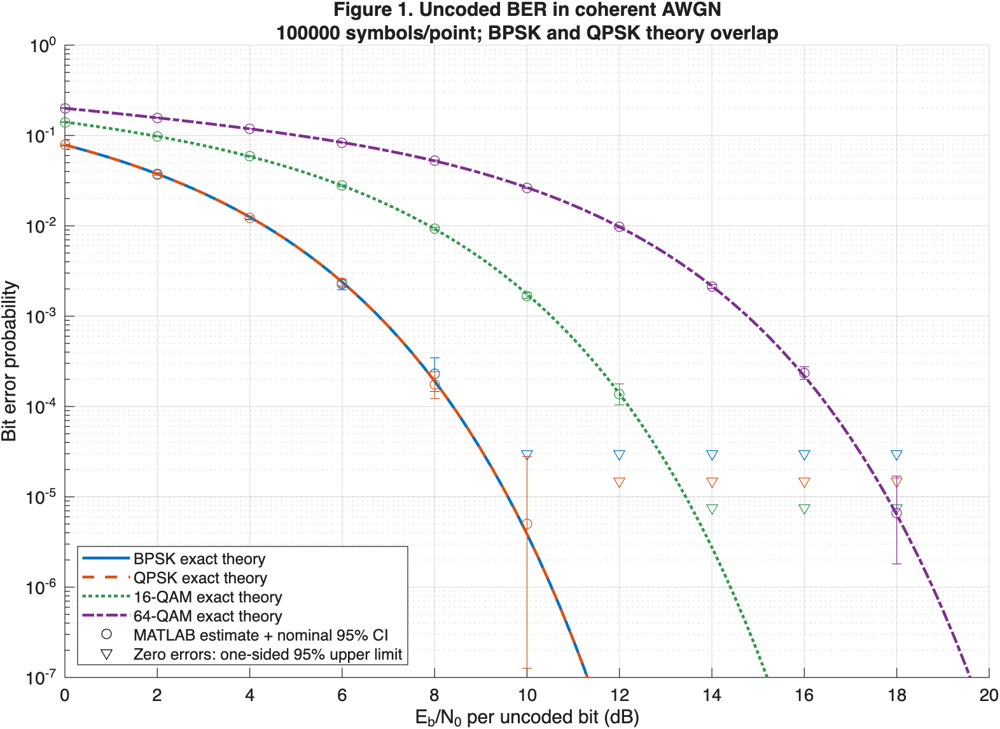
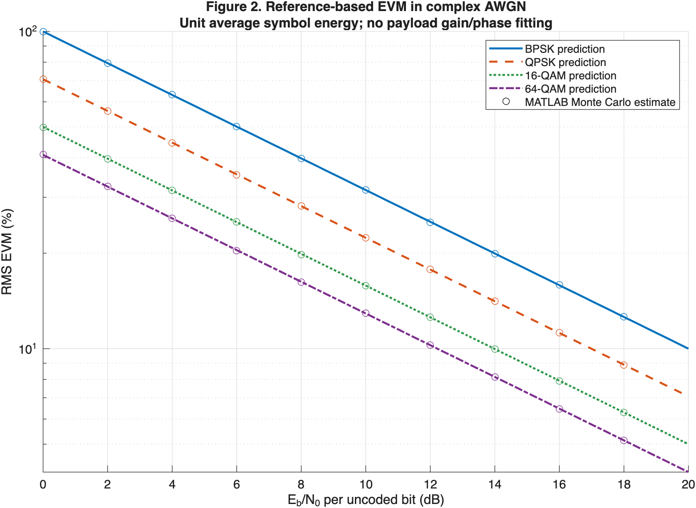
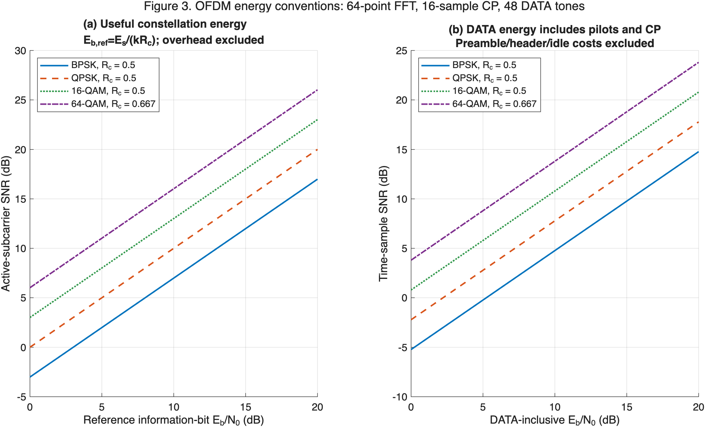
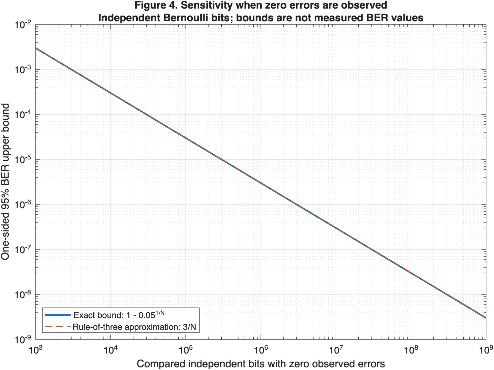
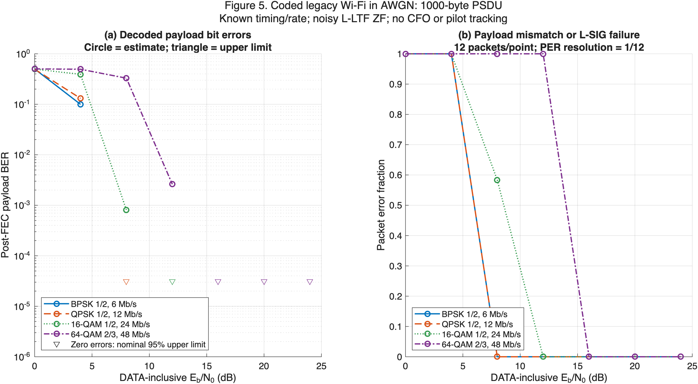
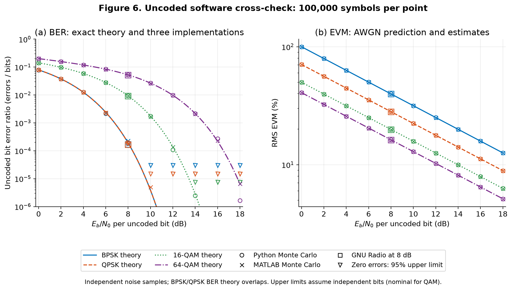
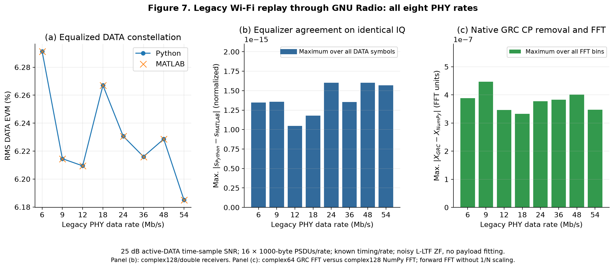
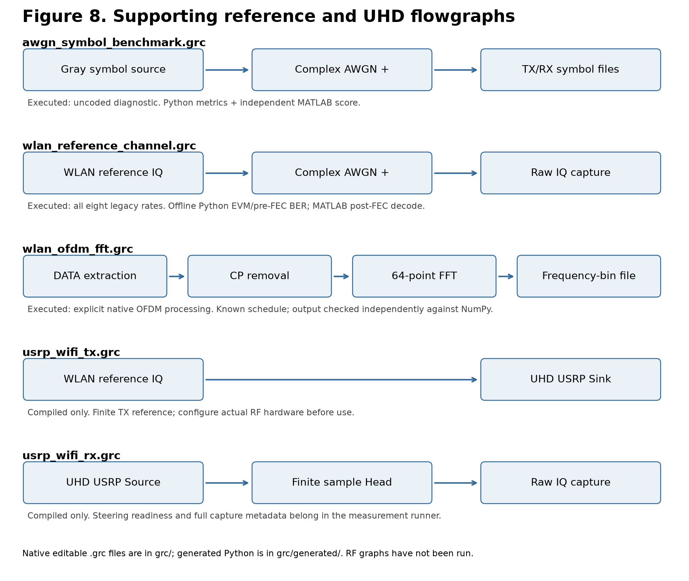

# SISO benchmark: supporting reference-validation appendix

Start with the [primary SISO results report](REPORT.md) and [live lab guide](../docs/SISO_LABS.md). This appendix retains the original reference baselines, theory figures and complete numerical tables.

Run completed **2026-10-17T18:14:38.334698+00:00**. Overall status: **PASSED**; **45 command stages** completed. All source hashes match this report generation. [Run manifest](validation/status.json) records exact commands, elapsed times, versions, and SHA-256 hashes.

These results validate the software measurement chain in simulation. They do not measure the developed antenna. The three supporting software flowgraphs were executed alongside the two new complete SISO labs; the two UHD graphs were compiled. Default UHD discovery found **no USRP device**. No RF streaming or live steering was performed.

## 1. Installation and reproducibility

| Component | Validated installation |
| --- | --- |
| Python | 3.12.15; `/Users/ofi/repos/grc/.venv/bin/python` |
| GNU Radio / UHD | 3.10.12.0 / 4.8.0.0-release |
| MATLAB | 26.1.0.3276743 (R2026a) Update 3; Communications Toolbox + WLAN Toolbox exercised |
| NumPy / SciPy / Matplotlib | 2.5.4 / 1.18.1 / 3.11.2 |
| Platform | macOS-26.5-arm64-arm-64bit |

**Installation fix:** installed this source tree as the editable `antenna-benchmark` package into radioconda with `--no-deps --no-build-isolation`; existing scientific/radio packages were retained. A subprocess running from `/tmp` with `PYTHONPATH` removed successfully imported the project, GNU Radio/UHD, GTK, Cairo, and scientific dependencies. The `antenna-grc` launcher selects that interpreter and executable path. [Diagnostic details](validation/install_check.json).

**Qt installation fix:** added the compatible conda-forge `pyqtwebengine`, `qt-webengine`, `giflib`, and `libwebp` packages. The package transaction replaced no existing packages. Importing `PyQt5.QtWebEngineWidgets.QWebEngineView` succeeds, fixing the missing documentation-browser component found during the Qt frontend startup check. [Transaction plan](validation/qt_webengine_plan.json), [installation log](validation/qt_webengine_install.log).

Open the five flowgraphs by double-clicking [Open Benchmark GRC.command](../Open%20Benchmark%20GRC.command), or run `/Users/ofi/radioconda/bin/antenna-grc`. The launcher uses the installed GTK frontend. The system Xcode command-line tools separately report an unaccepted Xcode license; no license was accepted, and this validation uses radioconda executables.

**Folder-local environment:** `.venv` shares the installed radioconda native/scientific libraries via `--system-site-packages`; direnv activates it automatically in interactive project terminals. The interpreter recorded above identifies the environment used for this run. [Environment setup and verification](../docs/ENVIRONMENT.md), [executed shell-transition checks](validation/project_environment_check.json).

Reproduce everything from the repository:

```sh
cd /Users/ofi/repos/grc
/Users/ofi/repos/grc/.venv/bin/python scripts/run_all.py
```

On another machine, install the project into that machine's GNU Radio Python using `python -m pip install --no-deps --no-build-isolation -e .`, then use `antenna-grc`. The double-click `.command` file is specific to this Mac. MATLAB needs licensed Communications and WLAN Toolboxes. Results are replaced on rerun; archive `results/` before changing the experiment.

## 2. Flowgraph execution evidence

| Editable GRC source | Validation performed | Result |
| --- | --- | --- |
| [awgn_symbol_benchmark.grc](../grc/awgn_symbol_benchmark.grc) | Compiled; finite execution at M = 2, 4, 16, 64; counts, noise power, BER envelope; independent MATLAB fixture scoring | PASS |
| [wlan_reference_channel.grc](../grc/wlan_reference_channel.grc) | Compiled; all 8 rates; exact expected packet availability; Python pre-FEC BER/EVM and MATLAB post-FEC decoding | PASS |
| [wlan_ofdm_fft.grc](../grc/wlan_ofdm_fft.grc) | Compiled; all 8 rates; vector counts and every FFT bin compared with NumPy on identical IQ | PASS |
| [usrp_wifi_tx.grc](../grc/usrp_wifi_tx.grc) | Native UHD blocks compiled; no radio found; no transmission | COMPILE ONLY |
| [usrp_wifi_rx.grc](../grc/usrp_wifi_rx.grc) | Native UHD blocks compiled; no radio found; no streaming | COMPILE ONLY |

The compiler's “no flow control” warning on finite software graphs is expected: finite files/vectors run to completion as quickly as possible. Their termination and output lengths are checked. UHD supplies the sample clock in hardware graphs. CLI compilation/runtime and GTK import checks are automated; interactive toolbar operation is not asserted by the test suite.

### Native GNU Radio symbol graph, 8 dB uncoded Eb/N0

| Modulation | Compared bits | Bit errors | Observed BER | Exact BER | RMS EVM (%) | Noise power / target |
| --- | --- | --- | --- | --- | --- | --- |
| BPSK | 100000 | 17 | 0.00017 | 0.00019091 | 39.738 | 0.99634 |
| QPSK | 200000 | 33 | 0.000165 | 0.00019091 | 28.099 | 0.99634 |
| 16-QAM | 400000 | 3681 | 0.0092025 | 0.0092472 | 19.865 | 0.99634 |
| 64-QAM | 600000 | 31087 | 0.051812 | 0.052334 | 16.218 | 0.99634 |

Every case contains exactly 100,000 TX/RX symbols. The noise-power tolerance is ±3%; the BER check uses a conservative six-standard-deviation envelope with a symbol-based variance bound to allow correlated QAM bit decisions. [Per-case results](grc/symbol_runtime_validation.json); [MATLAB cross-check](grc/matlab_cross_validation.json).

## 3. Uncoded theory, Monte Carlo, and uncertainty

BPSK/QPSK use the coherent exact BER expression; square QAM integrates every PAM decision region and Hamming distance. Each implementation uses unit average symbol energy and complex AWGN power `N0 = 1/(log2(M) × 10^(EbNo_dB/10))`. Python and MATLAB use independently generated samples, so their observed BER need not be identical. The MATLAB exact calculation agrees with `berawgn` to a worst relative error of **1.17e-14** where the oracle BER exceeds 1e-14. [Derivation](../docs/THEORY.md), [MathWorks analytical expressions](https://www.mathworks.com/help/comm/ug/analytical-expressions-used-in-berawgn-function-and-bit-error-rate-analysis-app.html).



**Figure 1. Exact uncoded BER and MATLAB Monte Carlo.** Blue solid: BPSK; orange dashed: QPSK; green dotted: 16-QAM; purple dash-dot: 64-QAM. Circles show BER estimates with nominal two-sided 95% bit-binomial confidence bars. Downward triangles show one-sided 95% upper limits when zero errors occur; they are not BER estimates. BPSK and QPSK exact curves overlap. 100,000 symbols per simulated point. [Vector PDF](theory/ber_vs_ebno.pdf).



**Figure 2. RMS EVM versus uncoded Eb/N0.** Colors and line styles identify the same four modulations as Figure 1; lines predict `100/sqrt(log2(M) × Eb/N0)`, circles are MATLAB estimates. EVM is normalized by the total known reference-symbol energy, with no payload gain/phase fit. [EVM definition](https://www.mathworks.com/help/comm/ref/comm.evm-system-object.html). [Vector PDF](theory/evm_vs_ebno.pdf).



**Figure 3. Two different OFDM energy conventions.** (a) Constellation reference: `SNR_sc = EbNo_ref + 10log10(k Rc)`. (b) DATA-inclusive reference: `SNR_sample = EbNo_DATA + 10log10(48 k Rc / 80)`. Legends state modulation and code rate. DATA energy includes pilots and CP; preamble, header, idle, and padding efficiency are excluded. The two x-axis quantities have different definitions and must not be interchanged. [WLAN SNR definitions](https://www.mathworks.com/help/wlan/ug/snr-definition-used-in-end-to-end-simulations.html). [Vector PDF](theory/ofdm_snr_conventions.pdf).



**Figure 4. Zero-error detection sensitivity.** Solid: exact one-sided 95% bound `1 - 0.05^(1/N)`; dashed: `3/N` approximation. This assumes independent Bernoulli trials. Multiple bit errors within a QAM symbol and post-FEC bursts can be correlated; bit-binomial bounds for those cases are nominal. [Clopper–Pearson reference](https://doi.org/10.1093/biomet/26.4.404). [Vector PDF](theory/zero_error_confidence.pdf).

## 4. Coded legacy Wi-Fi AWGN sweep

This separate MATLAB experiment covers **28 rate/EbNo points**, **12 independently noised 1000-byte PSDUs per point. Timing/rate/length are supplied. The receiver uses a noisy, unsmoothed L-LTF channel estimate and ZF equalization, with no CFO or pilot tracking in this AWGN case. These are decoded payload BER and packet error fraction, not the uncoded formulas of Figure 1.



**Figure 5. Coded Wi-Fi BER and PER.** Both legends state modulation, coding rate, and PHY rate. Circles are observed estimates; lines only join sampled estimates. BER triangles show nominal independent-bit one-sided 95% zero-error limits. PER counts payload mismatch or L-SIG failure. With only 12 packets per point, PER increments are 1/12, and observing zero failed packets still gives a one-sided 95% independent-packet PER upper limit of about 0.221. Coincident zero-error upper limits overlap. This exploratory sweep is insufficient for a low-PER paper claim. [Vector PDF](wlan_awgn/coded_wlan_ber_per.pdf).

## 5. Cross-language and native FFT results



**Figure 6. Independent uncoded software implementations.** Color/line style identifies modulation and exact theory; circles identify Python, crosses MATLAB, squares GNU Radio at 8 dB. Downward triangles identify nominal one-sided 95% zero-error upper limits in either Monte Carlo implementation. (a) BER; (b) RMS EVM. All simulations use 100,000 symbols per point. See Appendix A for exact error counts. [Vector PDF](figures/python_matlab_comparison.pdf).

The Wi-Fi replay uses 20 Msamples/s, FFT length 64, CP length 16, 48 DATA tones, 4 pilots, 16 repeated 1000-byte PSDUs per rate, 512 leading samples, and 2000 idle samples per PPDU. The waveform comes from MATLAB WLAN Toolbox with scrambler state 93, zero window transition, and one common TX scale across all rates to cap peak magnitude at 0.5. GNU Radio adds complex AWGN at **25 dB active-DATA time-sample SNR**. The training-based equalizer adds estimation error, so equalized EVM is not simply `100 × 10^(-25/20)`. [PPDU generator](https://www.mathworks.com/help/wlan/ref/wlanwaveformgenerator.html), [rate configuration](https://www.mathworks.com/help/wlan/ref/wlannonhtconfig.html).



**Figure 7. Identical-capture validation across all eight legacy rates.** The x-axis is PHY data rate in Mb/s. (a) Python circles/line and MATLAB crosses: RMS DATA EVM. (b) Blue bars: maximum equalized-symbol difference; symbols are dimensionless, normalized constellation values. (c) Green bars: maximum native GRC FFT difference from NumPy; FFT units retain the unnormalized forward transform. The FFT operates after removing all 16 CP samples, without a window or frequency shift. Single-precision FFT rounding in (c) is distinct from receiver double-precision agreement in (b). [Vector PDF](figures/wlan_cross_validation.pdf).

| Rate (Mb/s) | Modulation / code | EVM Python (%) | EVM MATLAB (%) | Pre-FEC errors / mapped bits | Post-FEC errors / PSDU bits | Failed / expected packets |
| --- | --- | --- | --- | --- | --- | --- |
| 6 | BPSK 1/2 | 6.291325 | 6.291325 | 0 / 257280 | 0 / 128000 | 0 / 16 |
| 9 | BPSK 3/4 | 6.214576 | 6.214576 | 0 / 171264 | 0 / 128000 | 0 / 16 |
| 12 | QPSK 1/2 | 6.209460 | 6.209460 | 0 / 258048 | 0 / 128000 | 0 / 16 |
| 18 | QPSK 3/4 | 6.267039 | 6.267039 | 0 / 172032 | 0 / 128000 | 0 / 16 |
| 24 | 16-QAM 1/2 | 6.230672 | 6.230672 | 0 / 258048 | 0 / 128000 | 0 / 16 |
| 36 | 16-QAM 3/4 | 6.216049 | 6.216049 | 0 / 172032 | 0 / 128000 | 0 / 16 |
| 48 | 64-QAM 2/3 | 6.228625 | 6.228625 | 31 / 193536 | 0 / 128000 | 0 / 16 |
| 54 | 64-QAM 3/4 | 6.185040 | 6.185040 | 20 / 175104 | 0 / 128000 | 0 / 16 |

Pre-FEC compares hard decisions for transmitted mapped DATA bits, including encoded SERVICE/tail/pad. Post-FEC compares decoded PSDU payload bits. All expected packets were available in this schedule-assisted replay. Zero post-FEC errors are finite observations, not proof of BER = 0; error dependence prevents treating a simple bit-binomial bound as a calibrated post-FEC confidence interval.

| Rate (Mb/s) | FFT vectors × 64 bins | Maximum absolute error | Relative L2 error | Result |
| --- | --- | --- | --- | --- |
| 6 | 5360 | 3.8847e-07 | 8.3211e-08 | passed |
| 9 | 3568 | 4.4689e-07 | 8.3406e-08 | passed |
| 12 | 2688 | 3.4622e-07 | 7.7153e-08 | passed |
| 18 | 1792 | 3.3298e-07 | 7.7337e-08 | passed |
| 24 | 1344 | 3.773e-07 | 8.2553e-08 | passed |
| 36 | 896 | 3.8303e-07 | 8.2919e-08 | passed |
| 48 | 672 | 4.0153e-07 | 8.1601e-08 | passed |
| 54 | 608 | 3.4695e-07 | 8.1434e-08 | passed |

Worst shared-capture equalized-symbol difference: **1.601e-15**; worst pooled EVM difference: **1.388e-17**. Python and MATLAB assert identical pre-FEC error and bit counts. Native FFT checks require identical vector shapes and bin-wise `atol=2e-6, rtol=2e-5`. [Validation tolerances](../docs/VALIDATION.md).



**Figure 8. Flowgraph architecture and execution scope.** Boxes are processing stages; arrows carry complex samples or OFDM vectors. The first three rows were executed; the UHD rows were compiled. These diagrams summarize the actual editable native `.grc` files. [Vector PDF](figures/flowgraph_overview.pdf).

## 6. Boundaries for the antenna paper

The reference waveform follows legacy non-HT OFDM settings; this package is not a completed IEEE conformance audit or an associated Wi-Fi MAC. The synthetic PSDU has no implied MAC header/FCS. Autonomous packet acquisition, L-SIG-driven configuration, independent-clock synchronization, RF calibration, UHD stream health, live steering, and antenna comparisons remain unmeasured. Steering has a command/readiness/settling framework with a tested mock backend; a real hardware adapter is still required.

For RF data, use a calibrated cabled baseline, then compare reference antenna and AUT at controlled power, geometry, polarization, and environment. Archive beam commands, readiness/settling, actual radio settings, stream errors, packet availability, BER denominators, and repeat measurements. [Paper methods](../docs/PAPER_METHODS.md), [steering contract](../docs/WIFI_AND_STEERING.md).

The historical normative source is [IEEE Std 802.11a-1999, Clause 17](https://labs.ece.uw.edu/funlab/802/802.11a-1999.pdf); the final paper should identify the chosen consolidated IEEE edition. [Citations and claim traceability](../docs/REFERENCES.md) and [BibTeX](../references.bib) separate standards, implementation documentation, and mathematical references.

## Appendix A. All uncoded Monte Carlo points

### BPSK

| Eb/N0 (dB) | Exact BER | Python errors / bits | Python BER | Python EVM (%) | MATLAB errors / bits | MATLAB BER | MATLAB EVM (%) |
| --- | --- | --- | --- | --- | --- | --- | --- |
| 0 | 0.07865 | 7841 / 100000 | 0.07841 | 99.904 | 7875 / 100000 | 0.07875 | 99.914 |
| 2 | 0.037506 | 3792 / 100000 | 0.03792 | 79.558 | 3735 / 100000 | 0.03735 | 79.574 |
| 4 | 0.012501 | 1251 / 100000 | 0.01251 | 62.972 | 1226 / 100000 | 0.01226 | 63.132 |
| 6 | 0.0023883 | 215 / 100000 | 0.00215 | 50.147 | 225 / 100000 | 0.00225 | 50.207 |
| 8 | 0.00019091 | 18 / 100000 | 0.00018 | 39.938 | 23 / 100000 | 0.00023 | 39.834 |
| 10 | 3.8721e-06 | 0 / 100000 | 0 | 31.529 | 0 / 100000 | 0 | 31.679 |
| 12 | 9.006e-09 | 0 / 100000 | 0 | 25.130 | 0 / 100000 | 0 | 25.046 |
| 14 | 6.8102e-13 | 0 / 100000 | 0 | 19.964 | 0 / 100000 | 0 | 19.891 |
| 16 | 2.2674e-19 | 0 / 100000 | 0 | 15.857 | 0 / 100000 | 0 | 15.893 |
| 18 | 1.396e-29 | 0 / 100000 | 0 | 12.598 | 0 / 100000 | 0 | 12.608 |

### QPSK

| Eb/N0 (dB) | Exact BER | Python errors / bits | Python BER | Python EVM (%) | MATLAB errors / bits | MATLAB BER | MATLAB EVM (%) |
| --- | --- | --- | --- | --- | --- | --- | --- |
| 0 | 0.07865 | 15940 / 200000 | 0.0797 | 70.727 | 15792 / 200000 | 0.07896 | 70.692 |
| 2 | 0.037506 | 7526 / 200000 | 0.03763 | 56.096 | 7437 / 200000 | 0.037185 | 56.042 |
| 4 | 0.012501 | 2503 / 200000 | 0.012515 | 44.610 | 2465 / 200000 | 0.012325 | 44.581 |
| 6 | 0.0023883 | 447 / 200000 | 0.002235 | 35.405 | 472 / 200000 | 0.00236 | 35.359 |
| 8 | 0.00019091 | 39 / 200000 | 0.000195 | 28.222 | 35 / 200000 | 0.000175 | 28.159 |
| 10 | 3.8721e-06 | 0 / 200000 | 0 | 22.391 | 1 / 200000 | 5e-06 | 22.344 |
| 12 | 9.006e-09 | 0 / 200000 | 0 | 17.779 | 0 / 200000 | 0 | 17.791 |
| 14 | 6.8102e-13 | 0 / 200000 | 0 | 14.094 | 0 / 200000 | 0 | 14.135 |
| 16 | 2.2674e-19 | 0 / 200000 | 0 | 11.188 | 0 / 200000 | 0 | 11.228 |
| 18 | 1.396e-29 | 0 / 200000 | 0 | 8.891 | 0 / 200000 | 0 | 8.875 |

### 16-QAM

| Eb/N0 (dB) | Exact BER | Python errors / bits | Python BER | Python EVM (%) | MATLAB errors / bits | MATLAB BER | MATLAB EVM (%) |
| --- | --- | --- | --- | --- | --- | --- | --- |
| 0 | 0.14098 | 56303 / 400000 | 0.14076 | 49.923 | 55828 / 400000 | 0.13957 | 49.863 |
| 2 | 0.097742 | 38846 / 400000 | 0.097115 | 39.617 | 39142 / 400000 | 0.097855 | 39.680 |
| 4 | 0.058624 | 23387 / 400000 | 0.058467 | 31.522 | 23588 / 400000 | 0.05897 | 31.568 |
| 6 | 0.027871 | 11126 / 400000 | 0.027815 | 25.050 | 11122 / 400000 | 0.027805 | 25.067 |
| 8 | 0.0092472 | 3767 / 400000 | 0.0094175 | 19.976 | 3716 / 400000 | 0.00929 | 19.817 |
| 10 | 0.0017542 | 694 / 400000 | 0.001735 | 15.813 | 672 / 400000 | 0.00168 | 15.788 |
| 12 | 0.00013866 | 43 / 400000 | 0.0001075 | 12.540 | 55 / 400000 | 0.0001375 | 12.560 |
| 14 | 2.7632e-06 | 1 / 400000 | 2.5e-06 | 9.959 | 0 / 400000 | 0 | 9.973 |
| 16 | 6.2502e-09 | 0 / 400000 | 0 | 7.939 | 0 / 400000 | 0 | 7.917 |
| 18 | 4.5223e-13 | 0 / 400000 | 0 | 6.312 | 0 / 400000 | 0 | 6.288 |

### 64-QAM

| Eb/N0 (dB) | Exact BER | Python errors / bits | Python BER | Python EVM (%) | MATLAB errors / bits | MATLAB BER | MATLAB EVM (%) |
| --- | --- | --- | --- | --- | --- | --- | --- |
| 0 | 0.19984 | 119840 / 600000 | 0.19973 | 40.812 | 120416 / 600000 | 0.20069 | 40.893 |
| 2 | 0.15697 | 94483 / 600000 | 0.15747 | 32.415 | 94230 / 600000 | 0.15705 | 32.495 |
| 4 | 0.11852 | 71035 / 600000 | 0.11839 | 25.707 | 71135 / 600000 | 0.11856 | 25.735 |
| 6 | 0.083817 | 50411 / 600000 | 0.084018 | 20.442 | 50019 / 600000 | 0.083365 | 20.395 |
| 8 | 0.052334 | 31420 / 600000 | 0.052367 | 16.263 | 31597 / 600000 | 0.052662 | 16.228 |
| 10 | 0.026533 | 16077 / 600000 | 0.026795 | 12.930 | 15813 / 600000 | 0.026355 | 12.932 |
| 12 | 0.009724 | 5866 / 600000 | 0.0097767 | 10.250 | 5820 / 600000 | 0.0097 | 10.260 |
| 14 | 0.002154 | 1291 / 600000 | 0.0021517 | 8.145 | 1275 / 600000 | 0.002125 | 8.147 |
| 16 | 0.00021717 | 162 / 600000 | 0.00027 | 6.468 | 141 / 600000 | 0.000235 | 6.463 |
| 18 | 6.3511e-06 | 1 / 600000 | 1.6667e-06 | 5.124 | 4 / 600000 | 6.6667e-06 | 5.139 |

Raw counts of zero in these tables are observations. Figure triangles plot the associated upper limits instead of zero on a log axis. Full confidence bounds and energies: [Python CSV](python/awgn_results.csv), [MATLAB CSV](theory/matlab_awgn_results.csv), [dense exact theory CSV](theory/exact_theory.csv).

## Appendix B. All coded Wi-Fi sweep points

| Rate (Mb/s) | Eb/N0 DATA (dB) | Time SNR (dB) | Errors / payload bits | Post-FEC BER | Failed / packets | PER | RMS EVM (%) |
| --- | --- | --- | --- | --- | --- | --- | --- |
| 6 | 0 | -5.2288 | 48151 / 96000 | 0.50157 | 12 / 12 | 1 | 264.577 |
| 6 | 4 | -1.2288 | 9579 / 96000 | 0.099781 | 12 / 12 | 1 | 199.545 |
| 6 | 8 | 2.7712 | 0 / 96000 | 0 | 0 / 12 | 0 | 106.812 |
| 6 | 12 | 6.7712 | 0 / 96000 | 0 | 0 / 12 | 0 | 54.707 |
| 6 | 16 | 10.771 | 0 / 96000 | 0 | 0 / 12 | 0 | 32.754 |
| 6 | 20 | 14.771 | 0 / 96000 | 0 | 0 / 12 | 0 | 20.300 |
| 6 | 24 | 18.771 | 0 / 96000 | 0 | 0 / 12 | 0 | 12.665 |
| 12 | 0 | -2.2185 | 47511 / 96000 | 0.49491 | 12 / 12 | 1 | 199.200 |
| 12 | 4 | 1.7815 | 12581 / 96000 | 0.13105 | 12 / 12 | 1 | 107.234 |
| 12 | 8 | 5.7815 | 0 / 96000 | 0 | 0 / 12 | 0 | 65.814 |
| 12 | 12 | 9.7815 | 0 / 96000 | 0 | 0 / 12 | 0 | 36.857 |
| 12 | 16 | 13.782 | 0 / 96000 | 0 | 0 / 12 | 0 | 22.702 |
| 12 | 20 | 17.782 | 0 / 96000 | 0 | 0 / 12 | 0 | 14.507 |
| 12 | 24 | 21.782 | 0 / 96000 | 0 | 0 / 12 | 0 | 9.103 |
| 24 | 0 | 0.79181 | 47803 / 96000 | 0.49795 | 12 / 12 | 1 | 134.261 |
| 24 | 4 | 4.7918 | 37611 / 96000 | 0.39178 | 12 / 12 | 1 | 69.581 |
| 24 | 8 | 8.7918 | 77 / 96000 | 0.00080208 | 7 / 12 | 0.58333 | 41.709 |
| 24 | 12 | 12.792 | 0 / 96000 | 0 | 0 / 12 | 0 | 25.427 |
| 24 | 16 | 16.792 | 0 / 96000 | 0 | 0 / 12 | 0 | 15.913 |
| 24 | 20 | 20.792 | 0 / 96000 | 0 | 0 / 12 | 0 | 9.990 |
| 24 | 24 | 24.792 | 0 / 96000 | 0 | 0 / 12 | 0 | 6.269 |
| 48 | 0 | 3.8021 | 48185 / 96000 | 0.50193 | 12 / 12 | 1 | 77.670 |
| 48 | 4 | 7.8021 | 47482 / 96000 | 0.4946 | 12 / 12 | 1 | 47.413 |
| 48 | 8 | 11.802 | 31580 / 96000 | 0.32896 | 12 / 12 | 1 | 28.421 |
| 48 | 12 | 15.802 | 251 / 96000 | 0.0026146 | 12 / 12 | 1 | 17.822 |
| 48 | 16 | 19.802 | 0 / 96000 | 0 | 0 / 12 | 0 | 11.029 |
| 48 | 20 | 23.802 | 0 / 96000 | 0 | 0 / 12 | 0 | 7.088 |
| 48 | 24 | 27.802 | 0 / 96000 | 0 | 0 / 12 | 0 | 4.422 |

[Full coded sweep CSV](wlan_awgn/coded_wlan_awgn.csv), [settings manifest](wlan_awgn/manifest.json).

## Appendix C. Command log index

| Stage | Exit code | Elapsed (s) | Log |
| --- | --- | --- | --- |
| installation_check | 0 | 1.69 | [stdout/stderr](validation/01_installation_check.log) |
| python_reference | 0 | 0.66 | [stdout/stderr](validation/02_python_reference.log) |
| matlab_theory_and_references | 0 | 23.75 | [stdout/stderr](validation/03_matlab_theory_and_references.log) |
| unit_tests | 0 | 1.06 | [stdout/stderr](validation/04_unit_tests.log) |
| compile_grc | 0 | 2.05 | [stdout/stderr](validation/05_compile_grc.log) |
| grc_all_modulations | 0 | 2.43 | [stdout/stderr](validation/06_grc_all_modulations.log) |
| grc_symbol_simulation | 0 | 0.47 | [stdout/stderr](validation/07_grc_symbol_simulation.log) |
| score_grc_symbols | 0 | 0.44 | [stdout/stderr](validation/08_score_grc_symbols.log) |
| grc_wlan_rate_0 | 0 | 0.49 | [stdout/stderr](validation/09_grc_wlan_rate_0.log) |
| python_wlan_rate_0 | 0 | 0.46 | [stdout/stderr](validation/10_python_wlan_rate_0.log) |
| grc_ofdm_fft_rate_0 | 0 | 0.48 | [stdout/stderr](validation/11_grc_ofdm_fft_rate_0.log) |
| validate_grc_fft_rate_0 | 0 | 0.14 | [stdout/stderr](validation/12_validate_grc_fft_rate_0.log) |
| grc_wlan_rate_1 | 0 | 0.45 | [stdout/stderr](validation/13_grc_wlan_rate_1.log) |
| python_wlan_rate_1 | 0 | 0.44 | [stdout/stderr](validation/14_python_wlan_rate_1.log) |
| grc_ofdm_fft_rate_1 | 0 | 0.48 | [stdout/stderr](validation/15_grc_ofdm_fft_rate_1.log) |
| validate_grc_fft_rate_1 | 0 | 0.14 | [stdout/stderr](validation/16_validate_grc_fft_rate_1.log) |
| grc_wlan_rate_2 | 0 | 0.46 | [stdout/stderr](validation/17_grc_wlan_rate_2.log) |
| python_wlan_rate_2 | 0 | 0.45 | [stdout/stderr](validation/18_python_wlan_rate_2.log) |
| grc_ofdm_fft_rate_2 | 0 | 0.47 | [stdout/stderr](validation/19_grc_ofdm_fft_rate_2.log) |
| validate_grc_fft_rate_2 | 0 | 0.14 | [stdout/stderr](validation/20_validate_grc_fft_rate_2.log) |
| grc_wlan_rate_3 | 0 | 0.45 | [stdout/stderr](validation/21_grc_wlan_rate_3.log) |
| python_wlan_rate_3 | 0 | 0.42 | [stdout/stderr](validation/22_python_wlan_rate_3.log) |
| grc_ofdm_fft_rate_3 | 0 | 0.47 | [stdout/stderr](validation/23_grc_ofdm_fft_rate_3.log) |
| validate_grc_fft_rate_3 | 0 | 0.15 | [stdout/stderr](validation/24_validate_grc_fft_rate_3.log) |
| grc_wlan_rate_4 | 0 | 0.45 | [stdout/stderr](validation/25_grc_wlan_rate_4.log) |
| python_wlan_rate_4 | 0 | 0.43 | [stdout/stderr](validation/26_python_wlan_rate_4.log) |
| grc_ofdm_fft_rate_4 | 0 | 0.47 | [stdout/stderr](validation/27_grc_ofdm_fft_rate_4.log) |
| validate_grc_fft_rate_4 | 0 | 0.13 | [stdout/stderr](validation/28_validate_grc_fft_rate_4.log) |
| grc_wlan_rate_5 | 0 | 0.45 | [stdout/stderr](validation/29_grc_wlan_rate_5.log) |
| python_wlan_rate_5 | 0 | 0.44 | [stdout/stderr](validation/30_python_wlan_rate_5.log) |
| grc_ofdm_fft_rate_5 | 0 | 0.47 | [stdout/stderr](validation/31_grc_ofdm_fft_rate_5.log) |
| validate_grc_fft_rate_5 | 0 | 0.13 | [stdout/stderr](validation/32_validate_grc_fft_rate_5.log) |
| grc_wlan_rate_6 | 0 | 0.46 | [stdout/stderr](validation/33_grc_wlan_rate_6.log) |
| python_wlan_rate_6 | 0 | 0.43 | [stdout/stderr](validation/34_python_wlan_rate_6.log) |
| grc_ofdm_fft_rate_6 | 0 | 0.46 | [stdout/stderr](validation/35_grc_ofdm_fft_rate_6.log) |
| validate_grc_fft_rate_6 | 0 | 0.16 | [stdout/stderr](validation/36_validate_grc_fft_rate_6.log) |
| grc_wlan_rate_7 | 0 | 0.46 | [stdout/stderr](validation/37_grc_wlan_rate_7.log) |
| python_wlan_rate_7 | 0 | 0.44 | [stdout/stderr](validation/38_python_wlan_rate_7.log) |
| grc_ofdm_fft_rate_7 | 0 | 0.47 | [stdout/stderr](validation/39_grc_ofdm_fft_rate_7.log) |
| validate_grc_fft_rate_7 | 0 | 0.13 | [stdout/stderr](validation/40_validate_grc_fft_rate_7.log) |
| cross_validate_grc | 0 | 6.59 | [stdout/stderr](validation/41_cross_validate_grc.log) |
| live_siso_labs | 0 | 33.45 | [stdout/stderr](validation/42_live_siso_labs.log) |
| live_siso_matlab | 0 | 5.70 | [stdout/stderr](validation/43_live_siso_matlab.log) |
| summary_figures | 0 | 1.61 | [stdout/stderr](validation/44_summary_figures.log) |
| live_siso_figures | 0 | 2.83 | [stdout/stderr](validation/45_live_siso_figures.log) |

This index uses the current manifest only; older log files may remain after runner changes. Generated Python is in `grc/generated/`; reference and received IQ are little-endian complex64 `.c64` files. Per-rate `.mat`/`.json` files retain reference symbols, schedule, recovery outputs, and capture hashes. [File formats and commands](../docs/FLOWGRAPHS.md).

