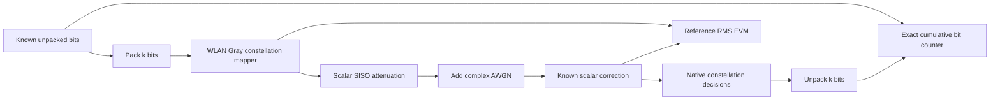
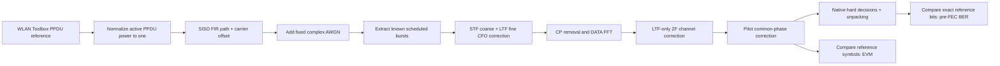

# SISO simulation labs: start here

The experiment is **one transmit stream and one receive stream**. A steerable antenna may contain many physical elements while still providing this single RF stream. No MIMO processing, spatial multiplexing, Wi-Fi association, MAC acknowledgements, or retransmissions is implemented.

## Open and run

In a new project terminal, `.venv` activates through direnv:

```sh
cd /Users/ofi/repos/grc
antenna-grc grc/siso_modem_lab.grc grc/siso_wlan_lab.grc
```

Open either graph, Generate with **F5**, Execute with **F6**, and Stop with **F7** (also available through the toolbar). Use GRC's Parameter block values to change the configuration, then regenerate/restart. These settings are intentionally fixed during a run; cumulative BER must not combine different channel conditions. The default count of zero means run continuously until Stop. A positive count makes a finite simulation; the window stays open to inspect the final values.

Alternatively run generated Python directly:

```sh
python grc/generated/siso_modem_lab.py --order 16 --ebno-db 8
python grc/generated/siso_wlan_lab.py --rate-index 4 --snr-db 25 --path-loss-db 6
python grc/generated/siso_wlan_lab.py --rate-index 4 --snr-db 35 --path-loss-db 3 --cfo-hz 20000 --channel-taps '1,0.2+0.15j,0,-0.1j'
```

The Wi-Fi lab requires reference files from `matlab/export_wlan_reference.m`. They are already generated on this Mac; `python scripts/run_all.py` recreates them and both flowgraphs. The new labs use normal Embedded Python wrappers for the project receiver/metric classes, so no compiled out-of-tree module or extra GRC block-path configuration is needed. The installed editable project must remain importable. Double-click an Embedded Python block to see its wrapper; implementation is in `antenna_bench/gr_metrics.py` and `antenna_bench/live.py`.

## What appears in the running window

| Tab | Display | Interpretation |
| --- | --- | --- |
| Metrics and constellation | Cumulative pre-FEC BER number | All compared bits since this run started, including wrong decisions |
| Metrics and constellation | Pooled RMS EVM number (%) | Sum error energies / sum reference energies, then square root; no RX DATA fit |
| Metrics and constellation | Blue RX DATA points and red reference crosses | Equalized constellation; QAM/BPSK symbols, not raw time-domain OFDM samples |
| TX waveform | Frequency, waterfall and time subtabs | Clean complex-baseband waveform before channel |
| RX waveform | Frequency, waterfall and time subtabs | Channel output before receiver correction |

Time views show I/Q at the logical signal sample rate. Frequency axes are complex baseband, centered at zero Hz. GNU Radio's FFT display level is a relative signal level; **it is not calibrated dBm or a calibrated PSD in dBm/Hz**. The report's Welch PSD uses a separately stated power-density normalization. Neither level is an antenna-gain calibration.

When stopping the graph, exact integer counts, EVM energies and configuration are saved to `results/live/siso_modem_{ber,evm}.json` or `siso_wlan_{ber,evm}.json`. The Wi-Fi receiver also saves `siso_wlan_receiver.json`, including recovered burst count and CFO estimates. These latest-session files are overwritten on the next run; archive them before changing conditions. The report uses separately archived finite cases under `results/live/cases/`, so manually opening a lab does not replace those report inputs.

## Lab 1: native SISO modem



This is the transparent calculation check: native bit packing, modulation, channel arithmetic, decisions and unpacking are visible in GRC. Supported orders are 2, 4, 16 and 64. It assumes perfect symbol timing and known scalar channel gain. It is a one-sample-per-symbol diagnostic, with no pulse shaping, OFDM or RF synchronization. Its spectrum is **not a Wi-Fi emission spectrum**.

TX nominal symbol energy is one. The `ebno_db` parameter is the **TX-reference uncoded Eb/N0**; complex noise variance is `1/(log2(M)*10^(ebno_db/10))`. `path_loss_db=L` multiplies signal amplitude by `10^(-L/20)` without changing the noise source. The effective received Eb/N0 is therefore `ebno_db-L` in this flat AWGN case. The known-gain equalizer restores signal scale and amplifies noise; it does not remove the loss penalty. At equal TX-reference Eb/N0, different modulation orders have different noise variance because k differs. Use Lab 2 for the fixed-noise, fixed-power modulation comparison.

| Parameter | Default | Meaning |
| --- | --- | --- |
| `order` | 16 | BPSK=2, QPSK=4, 16-QAM=16, 64-QAM=64 |
| `ebno_db` | 8 | TX-reference uncoded Eb/N0 in dB |
| `path_loss_db` | 0 | Additional signal power attenuation in dB |
| `symbol_count` | 0 | Zero: continuous; positive: exact finite symbol count |
| `pace` | 200000 | Symbol playback rate per wall-clock second; also the logical rate in this symbol-only lab |

## Lab 2: complete known-burst SISO Wi-Fi PHY



The transmitter replays actual legacy non-HT WLAN Toolbox PPDUs: 20 MHz, one spatial stream, FFT 64, CP 16, 48 DATA tones, 4 pilots, and a 1000-byte synthetic PSDU. Rate index 0..7 selects 6/9/12/18/24/36/48/54 Mb/s respectively. The waveform retains standard PHY coding, but the primary in-graph metric is **pre-FEC mapped-bit BER**, including transmitted DATA SERVICE/tail/pad bits. Post-FEC decoding remains an independent MATLAB baseline; it is not needed for this live counter.

Each PPDU is followed by 2000 zero samples. Burst starts, length and rate are supplied by the known schedule. This is a controlled PHY test, **not an autonomous Wi-Fi receiver**. Removing or inserting samples, unknown timing, arbitrary sample-clock offsets and missed-preamble acquisition are outside this mode. Counts of recovered bursts are integrity checks against the supplied schedule, not measured packet-detection sensitivity.

The SISO channel is `y[n] = exp(j*2*pi*f*n/fs) * sum_l h[l] x[n-l] + w[n]`. `h` is the entered causal FIR taps multiplied by the scalar attenuation. One tap is the flat baseline. Up to 16 taps fit within the 16-sample CP support used here. The taps are not automatically normalized: changing their magnitudes changes channel power. Received noise is added after attenuation/filtering and CFO, with variance fixed by the TX power reference.

The receiver estimates coarse CFO from the 16-sample STF repetition, fine CFO from the two LTF repetitions, and a per-tone channel from LTF only. It removes all 16 CP samples before the forward FFT. Pilot phase correction uses only known pilot tones; no received DATA symbols are fitted to their reference to lower EVM. This mode is tested for AWGN, causal multipath and CFO; it does not provide a general multipath acquisition guarantee.

| Parameter | Default | Meaning |
| --- | --- | --- |
| `rate_index` | 2 | QPSK 1/2, 12 Mb/s; see full rate table in FLOWGRAPHS.md |
| `snr_db` | 25 | **TX active-PPDU reference power / noise variance**, in dB |
| `path_loss_db` | 0 | Attenuates signal, leaves receiver noise fixed |
| `channel_taps` | `1+0j` | Comma-separated causal complex FIR taps |
| `cfo_hz` | 0 | Injected carrier-frequency offset at logical fs=20 MHz |
| `correct_cfo` | 1 | Enable STF/LTF correction; 0 is a diagnostic control |
| `pilot_tracking` | 1 | Enable pilot common-phase correction |
| `packet_count` | 0 | Zero: continuous; positive: finite number of PHY bursts |
| `pace` | 1000000 | Wall-clock playback samples/s; logical sample rate remains 20 Msps |

## Fixed power means a fixed reference plane

This Wi-Fi lab normalizes the **complete active PPDU's** average sample power to one separately for every rate. Idle samples are excluded. The noise variance is `10^(-snr_db/10)` and stays unchanged when path loss increases. For the unit flat path, nominal active-PPDU received SNR is `snr_db-path_loss_db`. DATA-only SNR differs slightly because the training/header/DATA powers need not match.

This differs intentionally from the older `wlan_reference_channel.grc`, whose SNR calibration uses the active DATA field and whose export uses a common peak-limiting scale. Never mix their SNR axes. Simulation samples may exceed magnitude one because they are floating point. Before hardware transmission, apply suitable DAC headroom and calibrate average **conducted TX power** at the chosen radio port. A fixed USRP gain setting or a peak-amplitude cap alone does not establish equal transmitted average power across waveforms. Keep RX gain fixed during antenna substitution.

## Validation, report and limits

`scripts/validate_live_labs.py` executes finite generated Qt graphs with the actual native plotting sinks and Qt event loop, using the offscreen backend for automation. It checks exact bits/symbols/bursts, no dropped channel samples, noise power, fixed active TX power, BER against theory for Lab 1, and independent scoring of saved Lab 2 data. The 34-case matrix includes four modulations, eight WLAN rates, four channel-loss points for representative rates, near-noiseless cases, multipath+CFO cases, and a disabled-corrections control that replays identical stored received IQ.

`matlab/validate_live_labs.m` independently checks every case's hard bit labels and EVM using WLAN/Communications Toolboxes. It also independently recovers raw IQ in the flat AWGN/no-tracking cases. GRC's streaming output is complex64, so that receiver comparison uses a 2e-6 absolute symbol tolerance; the older offline double-precision comparison has a separate, tighter tolerance. The new receiver's CFO/pilot path additionally has noiseless, known-frequency, and failing-control tests.

These are normalized simulations with a known schedule. They do not validate RF streaming, autonomous acquisition, hardware steering, physical antenna patterns, or calibrated antenna gain. For the initial antenna experiment: **set beam → wait/settle → capture a fixed block → score BER/EVM and received power**. Keep post-FEC/PER analyses optional until the SISO RF baseline is commissioned.

Sources: [legacy WLAN profile](https://www.mathworks.com/help/wlan/ref/wlannonhtconfig.html), [OFDM fields](https://www.mathworks.com/help/wlan/ref/wlannonhtofdminfo.html), [receiver corrections](https://www.mathworks.com/help/wlan/ref/wlannonhtdatarecover.html), [EVM normalization](https://www.mathworks.com/help/comm/ref/comm.evm-system-object.html), [GNU Radio Qt GUI](https://wiki.gnuradio.org/index.php/QT_GUI), [native constellation decisions](https://www.gnuradio.org/doc/doxygen/classgr_1_1digital_1_1constellation__decoder__cb.html). Definitions and caveats are expanded in THEORY.md; bibliography entries are in references.bib.
