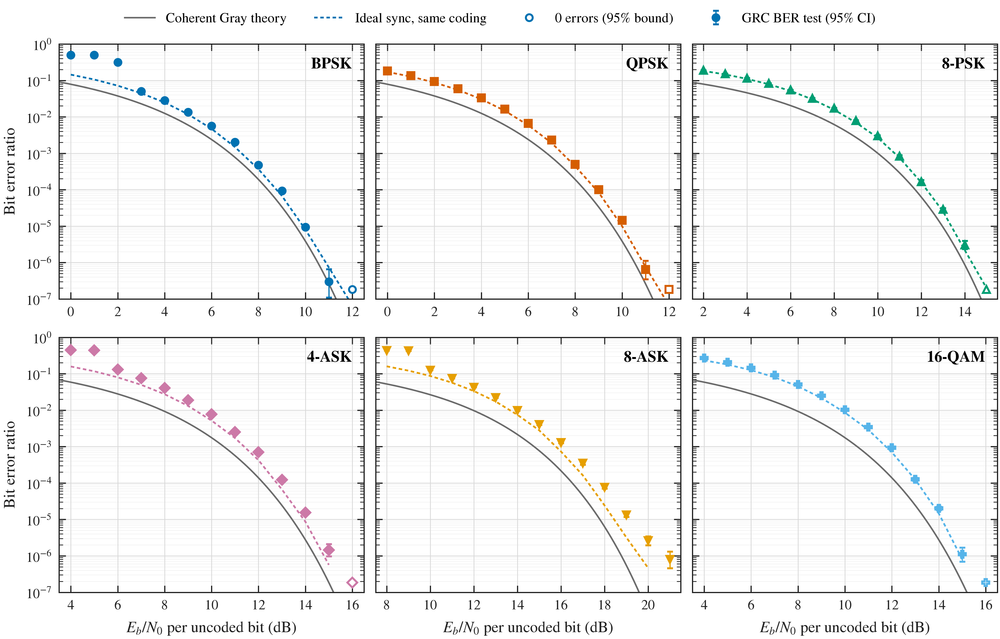
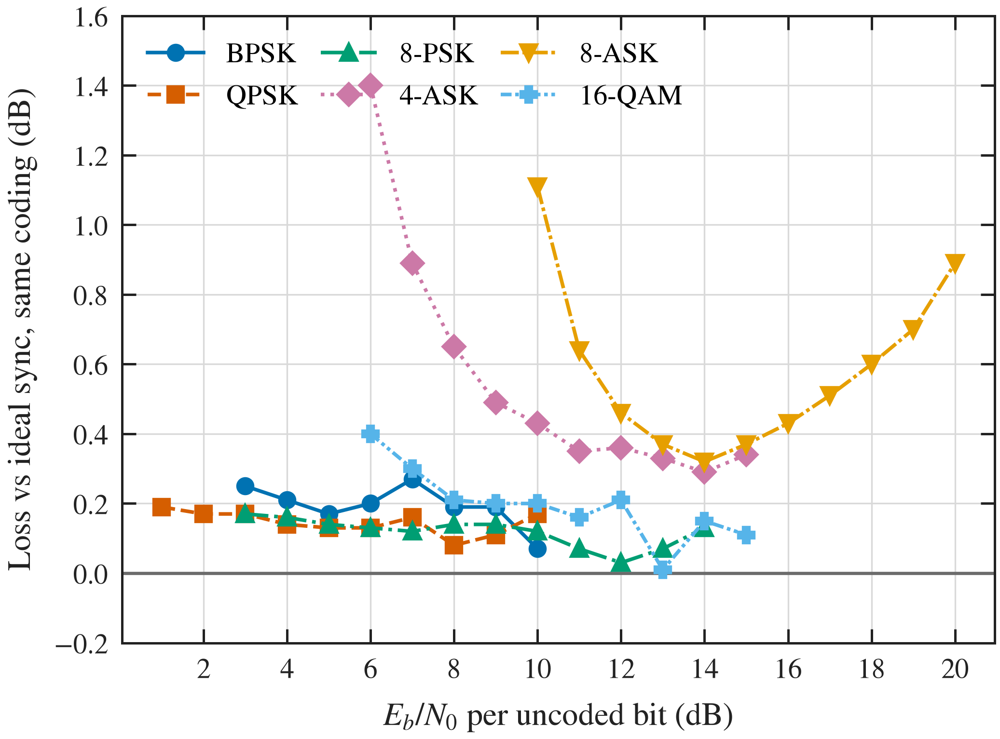
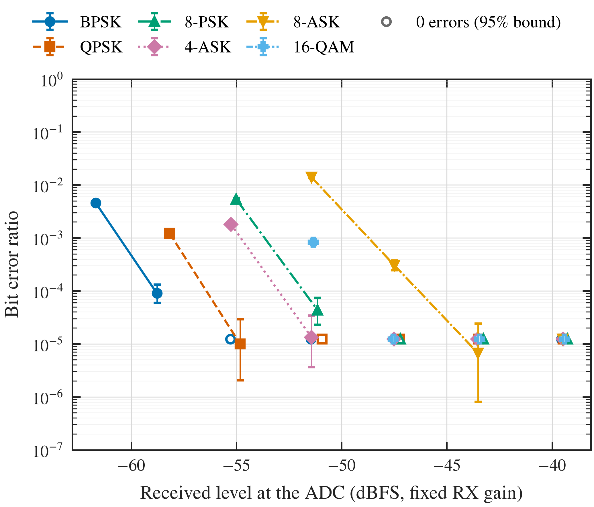
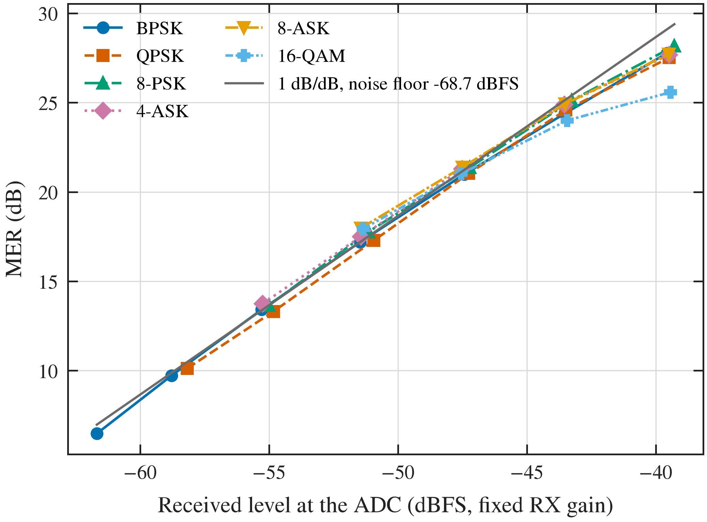
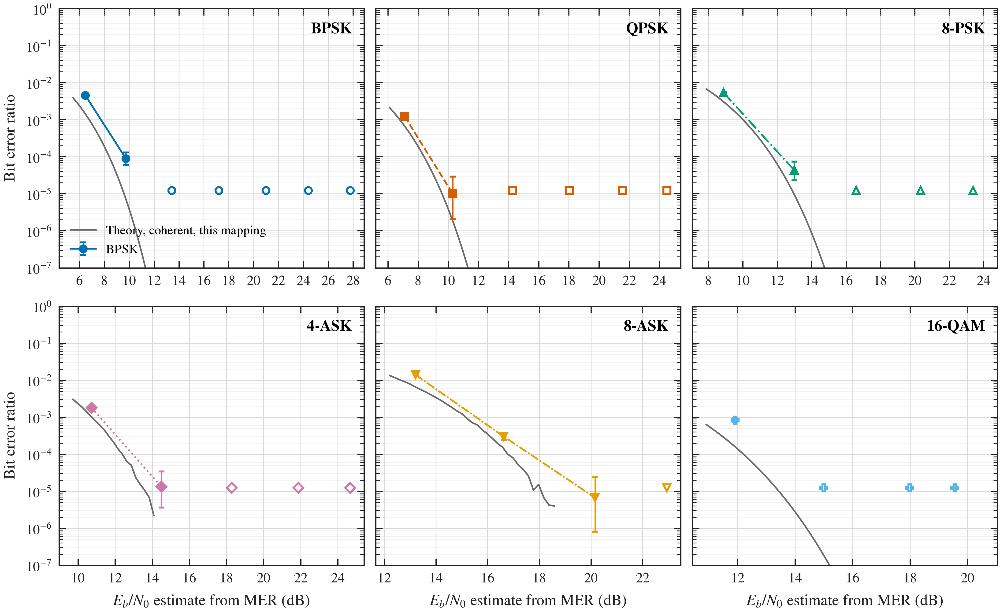

# Single-carrier simulation checks

## BER test results and sanity checks

These results come from the BER test built into each single-carrier flowchart, run by [scripts/ber_validation.py](../scripts/ber_validation.py) (the same test you get with [run_ber_test.py](../scripts/run_ber_test.py) or by pressing Run in GRC). In total 437,240,000 bits were compared across 80 Eb/N0 points. Each point ran until it had at least ~300 bit errors, or until it reached 20 million bits. Every error count was cross-checked against the flowchart's raw 10,000-bit error sums. Eb/N0 is per uncoded bit, with receiver noise integrated over Fs = 4 MHz. TX is 0 dBm with 80 dB net loss.

Two references:

- **Ideal sync, same coding:** a NumPy receiver with perfect timing and gain, the same constellation, the same bit mapping and the same differential coding. A correctly working receiver should match it; any excess is implementation loss.

- **Coherent Gray theory:** the textbook curve. The gap between it and the ideal-sync reference is the known cost of differential coding, and for ASK, of the stock natural (non-Gray) symbol order.

### Do the results make sense?

- **Noise off:** PASS. BPSK 0 errors in 10,000,000 bits, QPSK 0 errors in 10,000,000 bits, 8-PSK 0 errors in 10,000,000 bits, 4-ASK 0 errors in 10,000,000 bits, 8-ASK 0 errors in 10,000,000 bits, 16-QAM 0 errors in 10,000,000 bits.
- **BER falls as Eb/N0 rises:** PASS for every format, within 95% confidence intervals (excluding the loss-of-lock points below).
- **Close to the ideal-sync reference:** each point's equivalent Eb/N0 loss (how far the ideal receiver could back off and still reach the same BER) is BPSK 0.07–0.27 dB, QPSK 0.08–0.19 dB, 8-PSK 0.03–0.17 dB, 4-ASK 0.29–1.40 dB, 8-ASK 0.32–1.11 dB, 16-QAM 0.01–0.40 dB. A working timing loop and LMS equalizer should cost a few tenths of a dB, which PSK and 16-QAM do across the whole curve. The larger ASK values sit at two edges explained below: next to the loss-of-lock threshold, and for 8-ASK at high Eb/N0.
- **Agreement with the earlier, independently scored 250,000-bit sweep:** BPSK 7/7, QPSK 10/10, 8-PSK 12/12, 4-ASK 8/8, 8-ASK 9/9, 16-QAM 6/8 points with at least 10 sweep errors (95% intervals overlap; because differential decoding produces errors in pairs, intervals use half counts). The few exceptions differ by about 20%.
- **Loss of lock at the lowest Eb/N0:** BPSK at 0, 1, 2 dB; 4-ASK at 4, 5 dB; 8-ASK at 8, 9 dB. BER reads about 0.5 while an ideal receiver would still be below 0.2. There the timing loop and decision-directed equalizer cannot hold lock, so every bit is random. This is real receiver behaviour, not a counting error, and it is below any useful operating point. Loss of lock starts at a random moment, so these long runs catch it at slightly higher Eb/N0 than the earlier 250,000-bit sweep did (BPSK at 2 dB read 0.08 there).
- **Why ASK loses more at high Eb/N0.** With noise off, every format decodes error-free, but specific symbol patterns leave a small steady-state residual (timing and equalizer pattern noise), about 0.1 of the RMS amplitude at worst. PSK and 16-QAM have plenty of distance to their decision boundaries, so it costs them little. 8-ASK puts eight levels on one axis, only 0.22 RMS from each boundary, so those rare patterns close its eye noticeably. At low BER only those patterns fail, which is why 8-ASK's loss rises from about 0.3 dB at 14 dB to about 0.9 dB at 20 dB. This is a real receiver property, not a counting error. A narrower timing loop would reduce it.

| Modulation | Noise-off RMS EVM | Half decision spacing (× RMS) | Worst residual, 99.99% (× RMS) | Eye closure | Asymptotic loss limit (dB) |
| --- | ---: | ---: | ---: | ---: | ---: |
| BPSK | 1.02% | 1.000 | 0.0402 | 4.0% | 0.36 |
| QPSK | 0.79% | 0.707 | 0.0219 | 3.1% | 0.27 |
| 8-PSK | 0.81% | 0.383 | 0.0238 | 6.2% | 0.56 |
| 4-ASK | 1.19% | 0.447 | 0.0806 | 18.0% | 1.73 |
| 8-ASK | 1.24% | 0.218 | 0.0990 | 45.4% | 5.25 |
| 16-QAM | 0.87% | 0.316 | 0.0464 | 14.7% | 1.38 |

The last column is the loss approached only at extremely low BER, if the worst residual pattern lined up with the noise. The measured losses down to 10⁻⁶ stay well below it.

### Required Eb/N0 and implementation loss

| Modulation | BER | GRC BER test (dB) | Ideal sync, same coding (dB) | Gray theory (dB) | Implementation loss (dB) | Coding + mapping penalty (dB) |
| --- | ---: | ---: | ---: | ---: | ---: | ---: |
| BPSK | 1e-3 | 7.48 | 7.28 | 6.79 | +0.20 | +0.49 |
| BPSK | 1e-4 | 8.95 | 8.77 | 8.40 | +0.19 | +0.37 |
| QPSK | 1e-3 | 7.54 | 7.44 | 6.79 | +0.10 | +0.65 |
| QPSK | 1e-4 | 9.00 | 8.90 | 8.40 | +0.11 | +0.50 |
| 8-PSK | 1e-3 | 10.86 | 10.78 | 10.01 | +0.07 | +0.77 |
| 8-PSK | 1e-4 | 12.29 | 12.25 | 11.72 | +0.04 | +0.53 |
| 4-ASK | 1e-3 | 11.72 | 11.39 | 10.52 | +0.34 | +0.86 |
| 4-ASK | 1e-4 | 13.10 | 12.78 | 12.20 | +0.32 | +0.57 |
| 8-ASK | 1e-3 | 16.20 | 15.77 | 14.77 | +0.43 | +1.00 |
| 8-ASK | 1e-4 | 17.82 | 17.26 | 16.52 | +0.56 | +0.74 |
| 16-QAM | 1e-3 | 11.95 | 11.74 | 10.52 | +0.20 | +1.22 |
| 16-QAM | 1e-4 | 13.13 | 13.10 | 12.20 | +0.03 | +0.90 |

Spacing at BER 1e-4, relative to BPSK. The measured spacing should track the ideal-sync spacing; Gray theory is listed for comparison:

| Modulation | GRC BER test (dB) | Ideal sync, same coding (dB) | Gray theory (dB) |
| --- | ---: | ---: | ---: |
| BPSK | +0.00 | +0.00 | +0.00 |
| QPSK | +0.05 | +0.13 | +0.00 |
| 8-PSK | +3.34 | +3.49 | +3.33 |
| 4-ASK | +4.14 | +4.01 | +3.81 |
| 8-ASK | +8.87 | +8.49 | +8.12 |
| 16-QAM | +4.17 | +4.33 | +3.81 |

Expected physics, all visible above:

- BPSK and QPSK need the same Eb/N0 per bit.
- 8-PSK, 16-QAM and 4-ASK need roughly 3.5–4 dB more.
- 8-ASK needs about 8 dB more, because its levels are packed onto one axis.
- Differential coding roughly doubles the BER at high Eb/N0, because each symbol error corrupts two decoded symbols.
- For 16-QAM and ASK, differential coding on symbol indices also undoes Gray labelling, and the stock ASK constellations use natural order. Each symbol error therefore costs more bits.
- Together, the coding + mapping penalty is about 0.4–0.8 dB for PSK and up to 1.2 dB for 16-QAM, as in the table.

### Every point

| Modulation | Eb/N0 (dB) | Bits | Errors | BER | 95% CI | Ideal sync | Measured / ideal | Gray theory |
| --- | ---: | ---: | ---: | ---: | --- | ---: | ---: | ---: |
| BPSK | 0 | 1,000,000 | 497,647 | 4.976e-01 | 4.97e-01 – 4.99e-01 | 1.445e-01 | 3.44 | 7.86e-02 |
| BPSK | 1 | 1,000,000 | 500,649 | 5.006e-01 | 5.00e-01 – 5.02e-01 | 1.061e-01 | 4.72 | 5.63e-02 |
| BPSK | 2 | 1,000,000 | 317,107 | 3.171e-01 | 3.16e-01 – 3.18e-01 | 7.192e-02 | 4.41 | 3.75e-02 |
| BPSK | 3 | 1,000,000 | 50,241 | 5.024e-02 | 4.98e-02 – 5.07e-02 | 4.462e-02 | 1.13 | 2.29e-02 |
| BPSK | 4 | 1,000,000 | 28,134 | 2.813e-02 | 2.78e-02 – 2.85e-02 | 2.481e-02 | 1.13 | 1.25e-02 |
| BPSK | 5 | 1,000,000 | 13,412 | 1.341e-02 | 1.32e-02 – 1.36e-02 | 1.180e-02 | 1.14 | 5.95e-03 |
| BPSK | 6 | 1,000,000 | 5,654 | 5.654e-03 | 5.51e-03 – 5.80e-03 | 4.712e-03 | 1.20 | 2.39e-03 |
| BPSK | 7 | 1,000,000 | 2,014 | 2.014e-03 | 1.93e-03 – 2.10e-03 | 1.478e-03 | 1.36 | 7.73e-04 |
| BPSK | 8 | 1,000,000 | 474 | 4.740e-04 | 4.32e-04 – 5.19e-04 | 3.659e-04 | 1.30 | 1.91e-04 |
| BPSK | 9 | 4,500,000 | 418 | 9.289e-05 | 8.42e-05 – 1.02e-04 | 6.772e-05 | 1.37 | 3.36e-05 |
| BPSK | 10 | 20,000,000 | 188 | 9.400e-06 | 8.10e-06 – 1.08e-05 | 8.067e-06 | 1.17 | 3.87e-06 |
| BPSK | 11 | 20,000,000 | 6 | 3.000e-07 | 1.10e-07 – 6.53e-07 | 7.333e-07 | 0.41 | 2.61e-07 |
| BPSK | 12 | 20,000,000 | 0 | 0.000e+00 | 0.00e+00 – 1.84e-07 | 6.667e-08 | 0.00 | 9.01e-09 |
| QPSK | 0 | 1,000,000 | 181,528 | 1.815e-01 | 1.81e-01 – 1.82e-01 | 1.712e-01 | 1.06 | 7.86e-02 |
| QPSK | 1 | 1,000,000 | 134,937 | 1.349e-01 | 1.34e-01 – 1.36e-01 | 1.276e-01 | 1.06 | 5.63e-02 |
| QPSK | 2 | 1,000,000 | 93,663 | 9.366e-02 | 9.31e-02 – 9.42e-02 | 8.782e-02 | 1.07 | 3.75e-02 |
| QPSK | 3 | 1,000,000 | 59,634 | 5.963e-02 | 5.92e-02 – 6.01e-02 | 5.517e-02 | 1.08 | 2.29e-02 |
| QPSK | 4 | 1,000,000 | 33,159 | 3.316e-02 | 3.28e-02 – 3.35e-02 | 3.060e-02 | 1.08 | 1.25e-02 |
| QPSK | 5 | 1,000,000 | 16,225 | 1.622e-02 | 1.60e-02 – 1.65e-02 | 1.472e-02 | 1.10 | 5.95e-03 |
| QPSK | 6 | 1,000,000 | 6,656 | 6.656e-03 | 6.50e-03 – 6.82e-03 | 5.890e-03 | 1.13 | 2.39e-03 |
| QPSK | 7 | 1,000,000 | 2,302 | 2.302e-03 | 2.21e-03 – 2.40e-03 | 1.913e-03 | 1.20 | 7.73e-04 |
| QPSK | 8 | 1,000,000 | 494 | 4.940e-04 | 4.51e-04 – 5.40e-04 | 4.424e-04 | 1.12 | 1.91e-04 |
| QPSK | 9 | 5,140,000 | 518 | 1.008e-04 | 9.23e-05 – 1.10e-04 | 8.425e-05 | 1.20 | 3.36e-05 |
| QPSK | 10 | 20,000,000 | 287 | 1.435e-05 | 1.27e-05 – 1.61e-05 | 1.000e-05 | 1.44 | 3.87e-06 |
| QPSK | 11 | 20,000,000 | 13 | 6.500e-07 | 3.46e-07 – 1.11e-06 | 7.667e-07 | 0.85 | 2.61e-07 |
| QPSK | 12 | 20,000,000 | 0 | 0.000e+00 | 0.00e+00 – 1.84e-07 | 6.667e-08 | 0.00 | 9.01e-09 |
| 8-PSK | 2 | 1,000,000 | 189,259 | 1.893e-01 | 1.88e-01 – 1.90e-01 | 1.828e-01 | 1.04 | 7.93e-02 |
| 8-PSK | 3 | 1,000,000 | 151,916 | 1.519e-01 | 1.51e-01 – 1.53e-01 | 1.464e-01 | 1.04 | 6.18e-02 |
| 8-PSK | 4 | 1,000,000 | 115,563 | 1.156e-01 | 1.15e-01 – 1.16e-01 | 1.106e-01 | 1.04 | 4.58e-02 |
| 8-PSK | 5 | 1,000,000 | 82,700 | 8.270e-02 | 8.22e-02 – 8.32e-02 | 7.881e-02 | 1.05 | 3.18e-02 |
| 8-PSK | 6 | 1,000,000 | 54,598 | 5.460e-02 | 5.42e-02 – 5.50e-02 | 5.168e-02 | 1.06 | 2.05e-02 |
| 8-PSK | 7 | 1,000,000 | 32,293 | 3.229e-02 | 3.19e-02 – 3.26e-02 | 3.033e-02 | 1.06 | 1.20e-02 |
| 8-PSK | 8 | 1,000,000 | 17,292 | 1.729e-02 | 1.70e-02 – 1.75e-02 | 1.574e-02 | 1.10 | 6.18e-03 |
| 8-PSK | 9 | 1,000,000 | 7,870 | 7.870e-03 | 7.70e-03 – 8.05e-03 | 7.011e-03 | 1.12 | 2.75e-03 |
| 8-PSK | 10 | 1,000,000 | 3,016 | 3.016e-03 | 2.91e-03 – 3.13e-03 | 2.691e-03 | 1.12 | 1.01e-03 |
| 8-PSK | 11 | 1,000,000 | 831 | 8.310e-04 | 7.75e-04 – 8.89e-04 | 7.608e-04 | 1.09 | 2.94e-04 |
| 8-PSK | 12 | 2,360,000 | 394 | 1.669e-04 | 1.51e-04 – 1.84e-04 | 1.595e-04 | 1.05 | 6.34e-05 |
| 8-PSK | 13 | 18,000,000 | 519 | 2.883e-05 | 2.64e-05 – 3.14e-05 | 2.540e-05 | 1.14 | 9.42e-06 |
| 8-PSK | 14 | 20,000,000 | 61 | 3.050e-06 | 2.33e-06 – 3.92e-06 | 2.200e-06 | 1.39 | 8.76e-07 |
| 8-PSK | 15 | 20,000,000 | 0 | 0.000e+00 | 0.00e+00 – 1.84e-07 | 2.000e-07 | 0.00 | 4.52e-08 |
| 4-ASK | 4 | 1,000,000 | 444,658 | 4.447e-01 | 4.44e-01 – 4.46e-01 | 1.579e-01 | 2.82 | 5.86e-02 |
| 4-ASK | 5 | 1,000,000 | 437,012 | 4.370e-01 | 4.36e-01 – 4.38e-01 | 1.167e-01 | 3.75 | 4.19e-02 |
| 4-ASK | 6 | 1,000,000 | 131,588 | 1.316e-01 | 1.31e-01 – 1.32e-01 | 7.944e-02 | 1.66 | 2.79e-02 |
| 4-ASK | 7 | 1,000,000 | 75,325 | 7.533e-02 | 7.48e-02 – 7.58e-02 | 4.966e-02 | 1.52 | 1.70e-02 |
| 4-ASK | 8 | 1,000,000 | 40,302 | 4.030e-02 | 3.99e-02 – 4.07e-02 | 2.743e-02 | 1.47 | 9.25e-03 |
| 4-ASK | 9 | 1,000,000 | 18,840 | 1.884e-02 | 1.86e-02 – 1.91e-02 | 1.309e-02 | 1.44 | 4.39e-03 |
| 4-ASK | 10 | 1,000,000 | 7,730 | 7.730e-03 | 7.56e-03 – 7.90e-03 | 5.174e-03 | 1.49 | 1.75e-03 |
| 4-ASK | 11 | 1,000,000 | 2,519 | 2.519e-03 | 2.42e-03 – 2.62e-03 | 1.715e-03 | 1.47 | 5.65e-04 |
| 4-ASK | 12 | 1,000,000 | 703 | 7.030e-04 | 6.52e-04 – 7.57e-04 | 4.243e-04 | 1.66 | 1.39e-04 |
| 4-ASK | 13 | 4,180,000 | 513 | 1.227e-04 | 1.12e-04 – 1.34e-04 | 6.633e-05 | 1.85 | 2.42e-05 |
| 4-ASK | 14 | 20,000,000 | 311 | 1.555e-05 | 1.39e-05 – 1.74e-05 | 8.667e-06 | 1.79 | 2.76e-06 |
| 4-ASK | 15 | 20,000,000 | 29 | 1.450e-06 | 9.71e-07 – 2.08e-06 | 5.667e-07 | 2.56 | 1.84e-07 |
| 4-ASK | 16 | 20,000,000 | 0 | 0.000e+00 | 0.00e+00 – 1.84e-07 | 0.000e+00 | — | 6.25e-09 |
| 8-ASK | 8 | 1,000,000 | 432,190 | 4.322e-01 | 4.31e-01 – 4.33e-01 | 1.597e-01 | 2.71 | 5.23e-02 |
| 8-ASK | 9 | 1,000,000 | 423,947 | 4.239e-01 | 4.23e-01 – 4.25e-01 | 1.215e-01 | 3.49 | 3.85e-02 |
| 8-ASK | 10 | 1,000,000 | 125,278 | 1.253e-01 | 1.25e-01 – 1.26e-01 | 8.699e-02 | 1.44 | 2.65e-02 |
| 8-ASK | 11 | 1,000,000 | 74,549 | 7.455e-02 | 7.40e-02 – 7.51e-02 | 5.677e-02 | 1.31 | 1.69e-02 |
| 8-ASK | 12 | 1,000,000 | 42,601 | 4.260e-02 | 4.22e-02 – 4.30e-02 | 3.348e-02 | 1.27 | 9.72e-03 |
| 8-ASK | 13 | 1,000,000 | 22,100 | 2.210e-02 | 2.18e-02 – 2.24e-02 | 1.732e-02 | 1.28 | 4.95e-03 |
| 8-ASK | 14 | 1,000,000 | 9,783 | 9.783e-03 | 9.59e-03 – 9.98e-03 | 7.458e-03 | 1.31 | 2.15e-03 |
| 8-ASK | 15 | 1,000,000 | 4,015 | 4.015e-03 | 3.89e-03 – 4.14e-03 | 2.803e-03 | 1.43 | 7.72e-04 |
| 8-ASK | 16 | 1,000,000 | 1,298 | 1.298e-03 | 1.23e-03 – 1.37e-03 | 7.333e-04 | 1.77 | 2.17e-04 |
| 8-ASK | 17 | 1,000,000 | 351 | 3.510e-04 | 3.15e-04 – 3.90e-04 | 1.641e-04 | 2.14 | 4.50e-05 |
| 8-ASK | 18 | 7,340,000 | 560 | 7.629e-05 | 7.01e-05 – 8.29e-05 | 2.438e-05 | 3.13 | 6.35e-06 |
| 8-ASK | 19 | 20,000,000 | 265 | 1.325e-05 | 1.17e-05 – 1.49e-05 | 3.233e-06 | 4.10 | 5.54e-07 |
| 8-ASK | 20 | 20,000,000 | 52 | 2.600e-06 | 1.94e-06 – 3.41e-06 | 4.667e-07 | 5.57 | 2.63e-08 |
| 8-ASK | 21 | 20,000,000 | 16 | 8.000e-07 | 4.57e-07 – 1.30e-06 | 0.000e+00 | — | 5.85e-10 |
| 16-QAM | 4 | 1,000,000 | 269,379 | 2.694e-01 | 2.69e-01 – 2.70e-01 | 2.328e-01 | 1.16 | 5.86e-02 |
| 16-QAM | 5 | 1,000,000 | 205,946 | 2.059e-01 | 2.05e-01 – 2.07e-01 | 1.781e-01 | 1.16 | 4.19e-02 |
| 16-QAM | 6 | 1,000,000 | 144,344 | 1.443e-01 | 1.44e-01 – 1.45e-01 | 1.253e-01 | 1.15 | 2.79e-02 |
| 16-QAM | 7 | 1,000,000 | 91,756 | 9.176e-02 | 9.12e-02 – 9.23e-02 | 8.008e-02 | 1.15 | 1.70e-02 |
| 16-QAM | 8 | 1,000,000 | 50,724 | 5.072e-02 | 5.03e-02 – 5.12e-02 | 4.495e-02 | 1.13 | 9.25e-03 |
| 16-QAM | 9 | 1,000,000 | 24,928 | 2.493e-02 | 2.46e-02 – 2.52e-02 | 2.152e-02 | 1.16 | 4.39e-03 |
| 16-QAM | 10 | 1,000,000 | 10,293 | 1.029e-02 | 1.01e-02 – 1.05e-02 | 8.551e-03 | 1.20 | 1.75e-03 |
| 16-QAM | 11 | 1,000,000 | 3,432 | 3.432e-03 | 3.32e-03 – 3.55e-03 | 2.877e-03 | 1.19 | 5.65e-04 |
| 16-QAM | 12 | 1,000,000 | 933 | 9.330e-04 | 8.74e-04 – 9.95e-04 | 6.960e-04 | 1.34 | 1.39e-04 |
| 16-QAM | 13 | 3,360,000 | 424 | 1.262e-04 | 1.14e-04 – 1.39e-04 | 1.239e-04 | 1.02 | 2.42e-05 |
| 16-QAM | 14 | 16,360,000 | 329 | 2.011e-05 | 1.80e-05 – 2.24e-05 | 1.460e-05 | 1.38 | 2.76e-06 |
| 16-QAM | 15 | 20,000,000 | 22 | 1.100e-06 | 6.89e-07 – 1.67e-06 | 8.000e-07 | 1.38 | 1.84e-07 |
| 16-QAM | 16 | 20,000,000 | 0 | 0.000e+00 | 0.00e+00 – 1.84e-07 | 0.000e+00 | — | 6.25e-09 |

[All points (CSV)](ber_tests/ber_validation.csv), [summary (JSON)](ber_tests/summary.json).

## Over the air: N210 with two antennas

**Setup:** UBX N210 one-radio loopback, two antennas side by side (TX/RX and RX2 ports), 915 MHz. Center frequency 915 MHz, run 2026-11-08 16:50. Every point compared 300,000 bits with the actual transmitted data after sync ([scripts/n210_campaign.py](../scripts/n210_campaign.py), same sync-then-count method as run_n210_ber.py; the radio stays open and levels change live). The whole campaign took 313 s.

### At the flowcharts' default settings

Default settings: TX gain 10 dB, RX gain 10 dB, TX digital level -15 dBFS.

| Format | RX ADC (dBFS) | MER (dB) | Bits | Errors | BER (95% CI) | Losses of sync |
| --- | ---: | ---: | ---: | ---: | --- | ---: |
| BPSK | -14.7 | 32.3 | 300,000 | 0 | 0.00e+00 (0.0e+00 – 1.2e-05) | 0 |
| QPSK | -14.7 | 33.4 | 300,000 | 0 | 0.00e+00 (0.0e+00 – 1.2e-05) | 0 |
| 8-PSK | -14.5 | 34.8 | 300,000 | 0 | 0.00e+00 (0.0e+00 – 1.2e-05) | 0 |
| 4-ASK | -14.7 | 31.4 | 300,000 | 0 | 0.00e+00 (0.0e+00 – 1.2e-05) | 0 |
| 8-ASK | -14.7 | 30.7 | 300,000 | 0 | 0.00e+00 (0.0e+00 – 1.2e-05) | 0 |
| 16-QAM | -14.6 | 28.3 | 300,000 | 0 | 0.00e+00 (0.0e+00 – 1.2e-05) | 0 |

### BER and MER against received level

Gains fixed at TX 0 dB and RX 10 dB. The TX digital level was stepped down in 4 dB steps from -30 dBFS until a level could not sync. With the RX gain fixed, the ADC level tracks the received power 1:1.

How to read the plots:

- **MER against level:** MER should rise 1 dB per dB of received level until the receiver's own residual floor (about 33 dB on the cable loopback). The grey line marks where that 1:1 region extrapolates to 0 dB MER: the effective noise floor at the ADC.

- **BER against MER:** the over-the-air flowcharts use no differential coding, so the reference is coherent theory for this exact mapping (Gray for PSK/QAM, the stock natural order for ASK). The x-axis is the MER-based Eb/N0 estimate. MER is decision-directed, so it reads optimistic once decisions start failing, which pushes the lowest points to the right of the theory curve.

| Format | RX level at BER 1e-3 (dBFS) | RX level at BER 1e-4 (dBFS) | Weakest level that synced (dBFS) | Points |
| --- | ---: | ---: | ---: | ---: |
| BPSK | -60.6 | -58.9 | -61.7 | 7 |
| QPSK | -58.0 | -56.4 | -58.2 | 6 |
| 8-PSK | -53.7 | -51.8 | -55.0 | 5 |
| 4-ASK | -54.8 | -53.0 | -55.3 | 5 |
| 8-ASK | -48.7 | -46.3 | -51.4 | 4 |
| 16-QAM | — | -47.6 | -51.4 | 4 |

Losses of sync across all synced points: 0. Each one is a moment where the received bit stream jumped (for example a TX underflow, or a deep fade while something moved near the antennas). Its errors are counted in that point's BER, not hidden. [All points (CSV)](n210_campaign/summary.csv).

## Flowchart validation cases

Baseline: **1 Msymbol/s, four samples/symbol, 4 Msamples/s**. Six flat flowcharts containing only installed GNU Radio blocks. These are software simulations with zero carrier offset and no sample-rate mismatch.

| Modulation | RX noise (dBm over Fs) | Reference delay (bits) | Compared bits | Display BER, mean of windows | TX mean power (mW) |
| --- | ---: | ---: | ---: | ---: | ---: |
| BPSK | off | 34 | 250000 | 0 | 0.99963 |
| BPSK | -90.46 | 34 | 250000 | 0 | 0.99963 |
| QPSK | off | 68 | 250000 | 0 | 0.99963 |
| QPSK | -90.46 | 68 | 250000 | 0 | 0.99963 |
| 8PSK | off | 102 | 250000 | 0 | 0.99963 |
| 8PSK | -90.46 | 102 | 250000 | 0.000356 | 0.99963 |
| 4ASK | off | 68 | 250000 | 0 | 1.0009 |
| 4ASK | -90.46 | 68 | 250000 | 3.6e-05 | 1.0009 |
| 8ASK | off | 102 | 250000 | 0 | 1.0004 |
| 8ASK | -90.46 | 102 | 250000 | 0.05188 | 1.0004 |
| 16QAM | off | 136 | 250000 | 0 | 1.0022 |
| 16QAM | -90.46 | 136 | 250000 | 0.00678 | 1.0022 |

Each case verifies every XOR output bit against an independent TX/RX comparison and checks each Integrate/Multiply BER window. All six noiseless cases must have zero bit errors. The first 4096 output bits are excluded for filter and timing-loop startup.

BER is the fraction of errors in each nonoverlapping 10,000-bit window. It is not a cumulative counter. Differential encoding is enabled. Receiver noise is input-referred and integrated across Fs. Comparison with theory is in the BER test section above.

The stock EVM block is decision-directed. Its RMS-smoothed display can underestimate error at poor SNR because the nearest constellation point can be the wrong transmitted point. The exported data-aided constellation figures additionally compare the actual transmitted and received symbols without decision bias.

## Adaptive equalizer and 2×2 dashboards

All six live flowcharts use six resizable tabs with four charts per tab in a 2×2 grid. Controls are packed using their actual native GRC sizes with 8 px gaps. No plot canvas has a forced square size. Editable blue boxed section headings identify the transmitter, channel, receiver, BER measurement, and diagnostic areas in GRC; open with antenna-grc for the large heading style.

The receiver now includes a stock 11-tap, one-sample/symbol, decision-directed LMS Linear Equalizer after timing recovery. A centered identity initialization adds five symbols to the reference delay. A stock Python Snippet initializes the taps through the public API; all filtering/adaptation uses native GNU Radio blocks. The live tap-magnitude chart displays the actual adapting coefficients. Defaults: channel_echo=0, eq_step=0.01, native LMS step=eq_step/(eq_taps*symbol_rms²).

A 16-QAM case with a power-normalized one-symbol echo of 0.25 voltage ratio and normalized input noise 0.10 measured **24.67% before EQ → 5.64% after EQ**, with observed BER 0 over 250,000 compared bits. EVM uses actual aligned TX symbols after a 1,024-symbol warmup, with no amplitude/phase fit; its averaging interval can include remaining LMS convergence. This single controlled case does not establish performance for arbitrary multipath or carrier offsets. [Capture values](equalizer_checks/16qam_noise_0.1.json).

Each I/Q eye dashboard shows TX, raw channel RX, middle (after timing/before EQ), and after EQ. TX/RX use actual 4-SPS waveform samples. Middle/post eyes are explicitly **display-only RRC reconstructions of 1-SPS symbol streams**, not measured oversampled receiver signals. Their interpolation branches never feed BER decoding. Raw waveforms in these exported dashboards are converted to RMS symbol units using known TX/path levels.

Native GNU Radio Qt renders: [I-eye tab](live_dashboard_2.png), [constellations](live_dashboard_0.png), [BER/EVM/tap tab](live_dashboard_5.png). These show the actual resizable layout. Finite captures can finish before all live-sink refreshes; the numerical values above use the captured streams.

MATLAB independently recomputes native adaptive FIR outputs from captured per-symbol tap vectors and input samples, and reconstructs both RRC eye streams from saved symbols/taps. Sources: [GNU Radio Linear Equalizer](https://wiki.gnuradio.org/index.php/Linear_Equalizer), [GNU Radio LMS source](https://github.com/gnuradio/gnuradio/blob/v3.10.12.0/gr-digital/include/gnuradio/digital/adaptive_algorithm_lms.h).

## Link-budget power reference

[Three fixed-noise link-budget tests](link_budget_checks/summary.json) also verify that adding 10 dB TX power and 10 dB path loss preserves received power/BER, while reducing TX power at fixed loss/noise worsens BER.

IQ uses a power-wave convention: |IQ|² is milliwatts. TX average power defaults to 0 dBm, net path loss to 80 dB, and default RX noise to −100 dBm across the 4 MHz complex sample bandwidth. Received signal power is TX − net loss. The RX meter measures signal + noise. Validation cases explicitly set noise to their test values.

| Modulation | Set TX average (dBm) | Measured TX (dBm) | RX signal expectation (dBm) | RX total measured (dBm) | Sampled TX peak (dBm) | PAPR (dB) |
| --- | ---: | ---: | ---: | ---: | ---: | ---: |
| BPSK | 0.00 | -0.002 | -80.00 | -80.002 | 4.133 | 4.135 |
| QPSK | 0.00 | -0.002 | -80.00 | -80.002 | 3.937 | 3.939 |
| 8PSK | 0.00 | -0.002 | -80.00 | -80.002 | 3.854 | 3.855 |
| 4ASK | 0.00 | 0.004 | -80.00 | -79.996 | 6.464 | 6.460 |
| 8ASK | 0.00 | 0.002 | -80.00 | -79.998 | 7.395 | 7.393 |
| 16QAM | 0.00 | 0.009 | -80.00 | -79.991 | 6.290 | 6.280 |

Average and sampled peak meters use stock magnitude-squared, integration/max, and Log10 blocks. MATLAB independently validates their outputs and absolute TX/RX powers. Sample peaks at four samples/symbol are estimates of continuous-time PEP. These are simulated powers; no USRP output calibration has been performed. [Power controls and equations](../README.md#power-in-dbm-and-link-budgets).

## Data rate at 1 Msymbol/s

Gross uncoded bit rate is symbol rate × log2(M). Rates are 1, 2, 3, 2, 3, and 4 Mbit/s respectively. These are not measured packet goodput. With rolloff 0.35, ideal RRC null-to-null bandwidth is 1.35 MHz (complex baseband edges ±0.675 MHz). [CSV](data_rate.csv), [vector PDF](data_rate.pdf), [independent MATLAB chart](matlab_data_rate.png).

## BER versus Eb/N0

Each point is one finite capture of the saved flowchart (about 250,000 compared bits) with receiver noise set from the requested Eb/N0 under the Fs noise-bandwidth convention. Error bars are exact 95% Clopper-Pearson intervals; open markers had zero errors and sit at the one-sided 95% upper bound. [Data](ber_sweep/ber_sweep.csv), [vector PDF](ber_vs_ebno.pdf).

Dashed: ideal synchronization with the same constellation, bit mapping and differential coding (NumPy). Grey: textbook coherent Gray-coded AWGN theory. Above a few dB the flowchart measurements lie on the ideal-sync reference; the gap to Gray theory is the cost of differential coding and the stock (non-Gray) ASK symbol order. At the lowest Eb/N0, BPSK, 4-ASK and 8-ASK lose timing/equalizer lock (BER near 0.5), which is real receiver behavior.

Data-aided EVM follows 100/sqrt(Es/N0) for every format wherever the receiver is locked, an independent check of the noise convention.

## BER and EVM at one receiver-noise setting

All baseline runs use 0 dBm nominal conducted TX power, 80 dB net loss, and the same receiver noise power; decision-directed EVM can be optimistic when decisions are wrong. Noise and energy ratios use the documented Fs convention. Error bars are 95% Clopper-Pearson intervals; zero-error cases show the 95% upper bound.

## Independent MATLAB validation

MATLAB passed 16 actual capture cases: every XOR bit, BER window, stock per-symbol EVM, RMS smoothing, sample rate, gross bit rate, ideal RRC bandwidth, actual time-varying equalizer FIR output, and reconstructed eye waveforms. Maximum BER difference: 2.6e-09; maximum per-symbol EVM difference: 1.6e-05 percentage points. [MATLAB source](../matlab/validate_single_carrier.m), [machine-readable results](matlab_validation.json).

Stock EVM formula: [GNU Radio 3.10.12 source](https://github.com/gnuradio/gnuradio/blob/v3.10.12.0/gr-digital/lib/meas_evm_cc_impl.cc).

## RX SNR and Eb/N0

Live SNR uses measured TX average power minus known path loss and configured noise power over Fs. Eb/N0 adds 10 log10(Fs/bit_rate). These are known-reference link-budget readouts, not blind estimates from noisy RX samples. Noise disabled displays infinity. Defaults: SNR(Fs)=20 dB; Eb/N0=26.02, 23.01, 21.25, 23.01, 21.25, 20.00 dB across the six formats. The finite noisy test below uses −90.46 dBm noise and therefore different ratios.

## TX and RX constellation figures

TX symbols are the actual stock packing/differential-mapping monitor before pulse shaping. RX points are aligned with those TX symbols using the known latency, with no amplitude/phase fit. Dashed circles show the measured data-aided RMS error radius; they are not confidence contours or compliance limits.

### BPSK symbols

### QPSK symbols

### 8PSK symbols

### 4ASK symbols

### 8ASK symbols

### 16QAM symbols

MATLAB checks TX symbol encoding, data-aided EVM, and SNR/Eb/N0 readouts in addition to the stock meters. SNR conversion: [MathWorks convertSNR](https://www.mathworks.com/help/comm/ref/convertsnr.html). EVM normalization: [MathWorks EVM](https://www.mathworks.com/help/comm/ref/comm.evm-system-object.html).

## Two-N210 flowcharts: software loopback check

The generated n210_* flowcharts were run with both UHD blocks replaced by a software channel modelling two free-running radios: 3000 Hz carrier offset, 2 ppm sample-clock offset, 12345.4-sample delay, 137 deg carrier phase, -40 dB path, Es/N0 25 dB. Bits are scored against the true transmitted data after acquisition. This is not a hardware measurement.

| Modulation | BER vs TX data | Flowchart BER display | MER (dB) | TX sampled peak (dBFS) | Pass |
| --- | ---: | ---: | ---: | ---: | --- |
| BPSK | 0 | 0 | 24.4 | -10.9 | yes |
| QPSK | 0 | 0 | 24.5 | -11.0 | yes |
| 8PSK | 0 | 0 | 24.6 | -11.1 | yes |
| 4ASK | 0 | 0 | 24.6 | -8.4 | yes |
| 8ASK | 0 | 0 | 24.6 | -7.5 | yes |
| 16QAM | 0 | 0 | 23.7 | -8.9 | yes |

## Actual GRC canvas exports

### BPSK

### QPSK

### 8PSK

### 4ASK

### 8ASK

### 16QAM

Reference: [GNU Radio tutorial](https://wiki.gnuradio.org/index.php?title=M-ASK_Mod_and_Demod_and_QAM-M_Mod_and_Demod), read from the locally downloaded HTML and figures.
