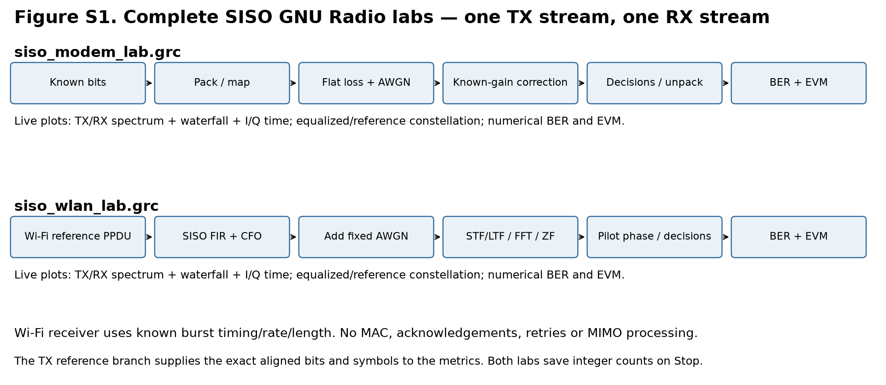
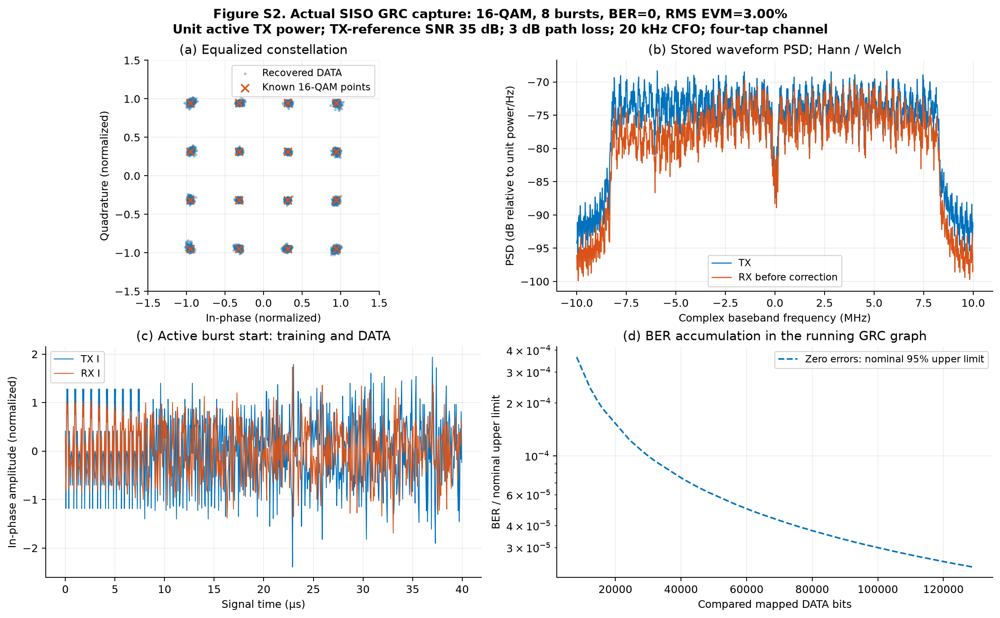
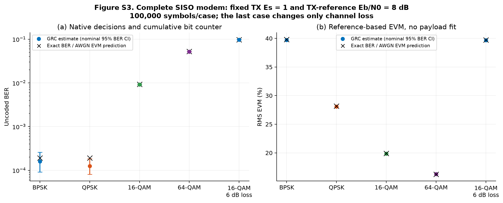
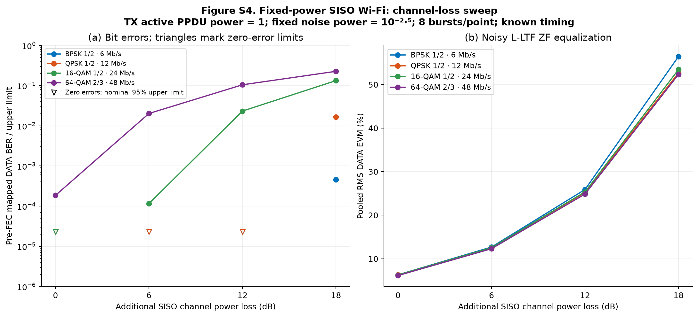
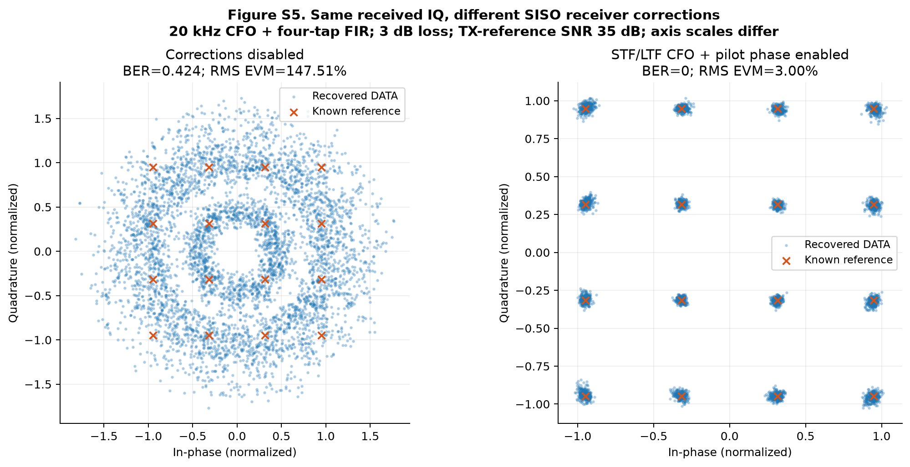

# SISO antenna benchmark — results and operating guide

**Software validation: PASS · 34 complete live-GRC cases · 46 command stages · one TX stream / one RX stream.** Run completed 2026-10-16T17:00:25.772526+00:00. [Commands, versions and source hashes](validation/status.json).

This report focuses on the agreed **fixed-power SISO experiment**: transmit a repeatable waveform, change only the SISO channel/antenna condition, and calculate **pre-FEC BER, RMS EVM and received power**. All results below are simulations. No antenna or USRP RF measurement has yet been performed.

## Read the results

The in-graph modem counter agrees with coherent uncoded theory across BPSK, QPSK, 16-QAM and 64-QAM. The Wi-Fi lab recovers all eight legacy rates with exact expected symbol and bit counts. With a four-tap channel and 20 kHz CFO, the 16-QAM example reports **0/129024 bit errors and 3.00% EVM**. Replaying the identical received IQ with CFO/pilot corrections disabled gives **BER 0.424 and 147.51% EVM**. This demonstrates why receiver corrections remain necessary even in a simplified measurement.

## Open the flowgraphs

From a new terminal in this folder:

```sh
cd /Users/ofi/repos/grc
antenna-grc grc/siso_modem_lab.grc grc/siso_wlan_lab.grc
```

Generate (**F5**), Execute (**F6**), Stop (**F7**). Settings are fixed per run; edit Parameter blocks and restart for a new condition. Zero counts mean continuous operation; positive counts make finite runs. The [detailed SISO guide](../docs/SISO_LABS.md) explains every block, parameter, view and output file.

| Graph | Use it for | Receiver assumption |
| --- | --- | --- |
| [SISO modem lab](../grc/siso_modem_lab.grc) | Transparent bits → mapping → channel → hard decisions → BER/EVM | Symbol timing and scalar channel are known |
| [SISO Wi-Fi lab](../grc/siso_wlan_lab.grc) | Actual OFDM bursts → FIR/CFO/AWGN → trained receiver → BER/EVM | Burst timing, rate and length are supplied; channel/CFO estimated from training |



**Figure S1. The two complete SISO signal paths.** Both calculate BER/EVM inside GNU Radio. The first isolates mapping and counting. The second uses legacy Wi-Fi PHY bursts and training-based reception. There is no Wi-Fi networking/MAC, MIMO processing, acknowledgment or retry logic. [PDF](live/figures/siso_flowgraphs.pdf) · [SVG](live/figures/siso_flowgraphs.svg).

## Live displays and saved evidence

The running window has a metrics/constellation tab and separate TX and RX waveform tabs. Each waveform tab contains frequency, waterfall and I/Q time views. The numerical readouts are cumulative BER and pooled RMS EVM. The overlaid constellation distinguishes the recovered DATA symbols from the known reference points. Raw OFDM waveform samples are not mislabeled as decoded constellation symbols.

On Stop, exact integer errors/bits, EVM energies, configuration and recovered burst/CFO information are written to `results/live/siso_*_{ber,evm,receiver}.json` as applicable. These latest-session files are overwritten. The report instead reads archived [finite cases](live/manifest.json), each containing metrics and a MATLAB fixture; selected cases also retain raw/reference/equalized arrays in `capture.npz`.



**Figure S2. Diagnostics from an actual finite execution of the generated SISO Wi-Fi GRC graph.** (a) Recovered 16-QAM DATA symbols and exact constellation points. (b) TX/RX Welch PSD at logical 20 Msps. (c) First 40 µs of the clean and received I waveform. (d) In-graph cumulative BER versus compared bits. Zero-error observations use nominal one-sided 95% upper limits. These are exported data plots, not GUI screenshots. PSD is relative power/Hz, not calibrated dBm/Hz; native Qt frequency displays use their own relative FFT-level scale. [PDF](live/figures/siso_dashboard.pdf) · [SVG](live/figures/siso_dashboard.svg).

## Modem calibration against theory



**Figure S3. Complete symbol-rate GRC modem versus theory.** Circles are in-graph measurements; crosses are exact uncoded BER and AWGN EVM predictions. Nominal BER confidence bars assume independent bits. Each case compares 100,000 symbols. TX nominal Es and TX-reference Eb/N0 remain fixed; the final 16-QAM case adds 6 dB loss. Noise variance varies with bits/symbol to hold Eb/N0 fixed across modulations; this is a diagnostic distinct from the Wi-Fi fixed-noise sweep. [PDF](live/figures/siso_modem_theory.pdf) · [SVG](live/figures/siso_modem_theory.svg).

| Modulation / loss | Errors / bits | GRC BER | Exact BER | RMS EVM (%) |
| --- | --- | --- | --- | --- |
| BPSK / 0 dB | 16/100000 | 0.00016 | 0.000190908 | 39.738 |
| QPSK / 0 dB | 25/200000 | 0.000125 | 0.000190908 | 28.099 |
| 16-QAM / 0 dB | 3688/400000 | 0.00922 | 0.00924721 | 19.882 |
| 64-QAM / 0 dB | 31270/600000 | 0.0521167 | 0.0523339 | 16.289 |
| 16-QAM / 6 dB | 39110/400000 | 0.097775 | 0.0977419 | 39.671 |

## Fixed power and the channel

In the Wi-Fi lab, **mean power over the complete active PPDU is exactly one**, separately for every rate. Idle zeros are excluded. The channel applies causal FIR taps, scalar attenuation and optional CFO, then adds complex AWGN. For the loss sweep, taps stay `[1]`, CFO stays zero, and noise variance stays **10^(-25/10)**. Only the scalar signal attenuation changes; the noise is never rescaled to hide the loss. With this flat path, nominal received active-PPDU SNR is `25 dB − path_loss_db`.

The `snr_db` label means **TX-reference active-PPDU power / noise power**. It differs from the older DATA-only SNR convention in the validation appendix. These normalized powers are not conducted watts or dBm. Hardware measurements still require TX power/headroom calibration at the radio port and fixed RX gain. An unchanged USRP gain setting alone does not prove equal transmitted average power across modulations.



**Figure S4. Fixed-power, fixed-noise SISO channel-loss sweep.** Colors/legends specify modulation, coding rate and PHY rate. Each point uses eight 1000-byte PHY bursts. (a) Mapped pre-FEC DATA BER; downward triangles represent nominal zero-error 95% upper limits, not measured nonzero BER. (b) Pooled DATA EVM after noisy L-LTF channel correction. Timing is supplied and CFO/pilot tracking is disabled for this AWGN-only comparison. These are simulated channel losses, not measured antenna steering angles. [PDF](live/figures/siso_fixed_power.pdf) · [SVG](live/figures/siso_fixed_power.svg).

| Rate (Mb/s) | Channel loss (dB) | Errors / mapped bits | BER | RMS EVM (%) | Active TX power |
| --- | --- | --- | --- | --- | --- |
| 6 | 0 | 0/128640 | 0 | 6.313 | 1.000000 |
| 6 | 6 | 0/128640 | 0 | 12.693 | 1.000000 |
| 6 | 12 | 0/128640 | 0 | 25.903 | 1.000000 |
| 6 | 18 | 59/128640 | 0.000458644 | 56.452 | 1.000000 |
| 12 | 0 | 0/129024 | 0 | 6.278 | 1.000000 |
| 12 | 6 | 0/129024 | 0 | 12.535 | 1.000000 |
| 12 | 12 | 0/129024 | 0 | 25.200 | 1.000000 |
| 12 | 18 | 2148/129024 | 0.0166481 | 52.700 | 1.000000 |
| 24 | 0 | 0/129024 | 0 | 6.272 | 1.000000 |
| 24 | 6 | 15/129024 | 0.000116257 | 12.552 | 1.000000 |
| 24 | 12 | 3011/129024 | 0.0233367 | 25.349 | 1.000000 |
| 24 | 18 | 17248/129024 | 0.133681 | 53.464 | 1.000000 |
| 48 | 0 | 18/96768 | 0.000186012 | 6.150 | 1.000000 |
| 48 | 6 | 1967/96768 | 0.020327 | 12.312 | 1.000000 |
| 48 | 12 | 10186/96768 | 0.105262 | 24.859 | 1.000000 |
| 48 | 18 | 22035/96768 | 0.22771 | 52.352 | 1.000000 |

## Receiver controls and independent checks



**Figure S5. Receiver correction control using identical recorded received IQ.** The disabled-corrections GRC run replays the enabled run’s stored waveform; an exact array comparison verifies this. Both use 16-QAM, a four-tap SISO channel, 20 kHz CFO, 3 dB attenuation and TX-reference SNR 35 dB. Axes have different scales. CFO is estimated from STF/LTF; common phase is estimated from pilots. No RX DATA reference fitting is used to lower EVM. Zero errors in the enabled case are a finite observation. [PDF](live/figures/siso_receiver_controls.pdf) · [SVG](live/figures/siso_receiver_controls.svg).

MATLAB independently checked **34** cases with WLAN Toolbox hard bit labels and `comm.EVM`. It independently recovered raw IQ for **20** flat AWGN/no-tracking cases. Worst EVM difference: **7.04e-14**; worst receiver symbol difference: **1.02e-06**, against the 2e-6 complex64/double tolerance. [MATLAB result](live/matlab_validation.json). The older offline double-precision receiver check remains separately documented.

The current checks include exact finite counts, no channel sample loss, fixed active TX power, noise calibration, noiseless recovery, multipath/CFO recovery and a deliberately failing receiver control. Qt tests construct the actual GNU Radio plotting sinks and run their event loop with the **offscreen** backend; they are not hardware or performance-throughput tests.

## Installation finding and fix

Runtime GUI testing found a real **Qt 5 / Qt 6 Qwt mismatch**: the installed GNU Radio plotting module required Qt 5, but the selected Qwt build loaded Qt 6 and aborted. Qwt 6.3.0 was replaced with Qt 5 build `h4ff56cd_0` and pinned in radioconda’s `conda-meta/pinned`. No GNU Radio, UHD, NumPy or MATLAB version was changed. [Transaction plan](validation/qwt_qt5_plan.json), [installation log](validation/qwt_qt5_install.log). The installation check now constructs a real Qt constellation widget in a subprocess, catching this failure before the full suite. [Environment check](validation/install_check.json).

## What this establishes for the antenna paper

The simulated **SISO measurement chain** works, with traceable counts and independent validation. The antenna experiment can remain: **set beam → settle → capture a fixed block → calculate BER/EVM and received power**. Keep post-FEC/PER work as an optional baseline. The receiver currently knows burst boundaries, rate and length; it does not establish autonomous acquisition sensitivity, sample-clock tracking, USRP stream integrity, live steering, antenna gain or an IEEE conformance result. No measured antenna improvement is claimed.

For the first RF experiment, commission an attenuated cabled SISO link, then substitute reference antenna/AUT while holding conducted TX power, RX gain, waveform, geometry and polarization fixed. Record received power alongside BER/EVM and compare commanded beam direction with the actual measured radiation pattern. [Methods](../docs/PAPER_METHODS.md), [steering contract](../docs/WIFI_AND_STEERING.md).

## Baselines, data and citations

The [validation appendix](VALIDATION_APPENDIX.md) retains all eight earlier theory/reference figures, complete uncoded/coded tables and the current command-log index. [Mathematical definitions](../docs/THEORY.md), [reference traceability](../docs/REFERENCES.md), [BibTeX](../references.bib), [SISO lab guide](../docs/SISO_LABS.md).

Waveform and receiver references: [legacy non-HT configuration](https://www.mathworks.com/help/wlan/ref/wlannonhtconfig.html), [WLAN recovery and EVM symbols](https://www.mathworks.com/help/wlan/ref/wlannonhtdatarecover.html), [EVM normalization](https://www.mathworks.com/help/comm/ref/comm.evm-system-object.html), [GNU Radio Qt displays](https://wiki.gnuradio.org/index.php/QT_GUI). An experimental precedent for USRP EVM versus steering angle is [Cho et al., EuMC 2024](https://doi.org/10.23919/EuMC61614.2024.10732723); it does not validate this implementation.

### Every archived live case

| Case | Compared bits | Bit errors | BER | RMS EVM (%) | Evidence |
| --- | --- | --- | --- | --- | --- |
| modem_2 | 100000 | 16 | 0.00016 | 39.7378 | [JSON](live/cases/modem_2/metrics.json) |
| modem_4 | 200000 | 25 | 0.000125 | 28.0988 | [JSON](live/cases/modem_4/metrics.json) |
| modem_16 | 400000 | 3688 | 0.00922 | 19.8825 | [JSON](live/cases/modem_16/metrics.json) |
| modem_64 | 600000 | 31270 | 0.0521167 | 16.2886 | [JSON](live/cases/modem_64/metrics.json) |
| modem_16_loss6 | 400000 | 39110 | 0.097775 | 39.6708 | [JSON](live/cases/modem_16_loss6/metrics.json) |
| wlan_0 | 128640 | 0 | 0 | 6.3135 | [JSON](live/cases/wlan_0/metrics.json) |
| wlan_1 | 85632 | 0 | 0 | 6.2043 | [JSON](live/cases/wlan_1/metrics.json) |
| wlan_2 | 129024 | 0 | 0 | 6.2775 | [JSON](live/cases/wlan_2/metrics.json) |
| wlan_3 | 86016 | 0 | 0 | 6.2783 | [JSON](live/cases/wlan_3/metrics.json) |
| wlan_4 | 129024 | 0 | 0 | 6.2724 | [JSON](live/cases/wlan_4/metrics.json) |
| wlan_5 | 86016 | 0 | 0 | 6.2637 | [JSON](live/cases/wlan_5/metrics.json) |
| wlan_6 | 96768 | 18 | 0.000186012 | 6.1498 | [JSON](live/cases/wlan_6/metrics.json) |
| wlan_7 | 87552 | 6 | 6.85307e-05 | 6.1764 | [JSON](live/cases/wlan_7/metrics.json) |
| wlan_0_loss6 | 128640 | 0 | 0 | 12.6930 | [JSON](live/cases/wlan_0_loss6/metrics.json) |
| wlan_0_loss12 | 128640 | 0 | 0 | 25.9031 | [JSON](live/cases/wlan_0_loss12/metrics.json) |
| wlan_0_loss18 | 128640 | 59 | 0.000458644 | 56.4524 | [JSON](live/cases/wlan_0_loss18/metrics.json) |
| wlan_0_clean | 128640 | 0 | 0 | 0.0000 | [JSON](live/cases/wlan_0_clean/metrics.json) |
| wlan_0_impaired | 128640 | 0 | 0 | 2.9779 | [JSON](live/cases/wlan_0_impaired/metrics.json) |
| wlan_2_loss6 | 129024 | 0 | 0 | 12.5351 | [JSON](live/cases/wlan_2_loss6/metrics.json) |
| wlan_2_loss12 | 129024 | 0 | 0 | 25.2003 | [JSON](live/cases/wlan_2_loss12/metrics.json) |
| wlan_2_loss18 | 129024 | 2148 | 0.0166481 | 52.6997 | [JSON](live/cases/wlan_2_loss18/metrics.json) |
| wlan_2_clean | 129024 | 0 | 0 | 0.0000 | [JSON](live/cases/wlan_2_clean/metrics.json) |
| wlan_2_impaired | 129024 | 0 | 0 | 2.9638 | [JSON](live/cases/wlan_2_impaired/metrics.json) |
| wlan_4_loss6 | 129024 | 15 | 0.000116257 | 12.5518 | [JSON](live/cases/wlan_4_loss6/metrics.json) |
| wlan_4_loss12 | 129024 | 3011 | 0.0233367 | 25.3493 | [JSON](live/cases/wlan_4_loss12/metrics.json) |
| wlan_4_loss18 | 129024 | 17248 | 0.133681 | 53.4643 | [JSON](live/cases/wlan_4_loss18/metrics.json) |
| wlan_4_clean | 129024 | 0 | 0 | 0.0000 | [JSON](live/cases/wlan_4_clean/metrics.json) |
| wlan_4_impaired | 129024 | 0 | 0 | 2.9974 | [JSON](live/cases/wlan_4_impaired/metrics.json) |
| wlan_6_loss6 | 96768 | 1967 | 0.020327 | 12.3123 | [JSON](live/cases/wlan_6_loss6/metrics.json) |
| wlan_6_loss12 | 96768 | 10186 | 0.105262 | 24.8595 | [JSON](live/cases/wlan_6_loss12/metrics.json) |
| wlan_6_loss18 | 96768 | 22035 | 0.22771 | 52.3516 | [JSON](live/cases/wlan_6_loss18/metrics.json) |
| wlan_6_clean | 96768 | 0 | 0 | 0.0000 | [JSON](live/cases/wlan_6_clean/metrics.json) |
| wlan_6_impaired | 96768 | 0 | 0 | 2.9740 | [JSON](live/cases/wlan_6_impaired/metrics.json) |
| wlan_4_uncorrected | 129024 | 54765 | 0.424456 | 147.5090 | [JSON](live/cases/wlan_4_uncorrected/metrics.json) |

